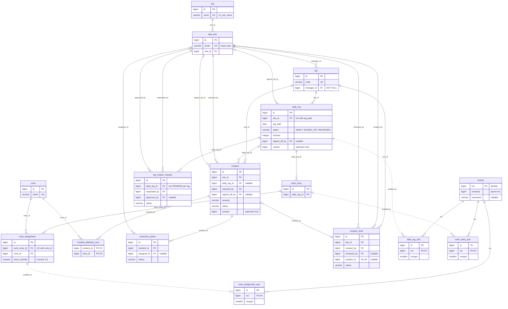

# Database schema

:::info Status (2026-11-04, milestone M2)
This page describes the schema exactly as the Flyway migrations in
`src/main/resources/db/migration/` create it. **The migrations are the source of truth**; if this
page and a migration disagree, the migration wins. Every rule below is covered by an integration
test against PostgreSQL 17 (Testcontainers) in `src/test/java/hr/algebra/sitelog/db/`.
JPA entities, services and Envers mappings are not written yet; they must match this schema
because Hibernate runs with `ddl-auto=validate`.

Related pages: [domain model](./domain-model.md) (entities, roles, state machines),
[architecture overview](./overview.md) (layers and request flows),
[ADR-0001](../adr/0001-persistence-model.md) (persistence model),
[ADR-0003](../adr/0003-reopen-audit-trail.md) (reopen audit trail).
:::

## Migrations

| Migration | Creates |
|---|---|
| `V1__baseline.sql` | Nothing (comment only). Marks the start of the Flyway history. |
| `V2__sites_crews_daily_logs.sql` | `role` (+ the four role rows), `app_user`, `site`, `crew`, and the daily log aggregate `daily_log` → `work_entry` → `crew_assignment`. |
| `V3__incidents_and_reopen.sql` | `incident`, `incident_affected_crew`, `corrective_action`, `log_reopen_request`, `incident_draft`; the lock functions and triggers for signed-off daily logs; the Envers tables `revinfo`, `daily_log_aud`, `work_entry_aud`, `crew_assignment_aud`. |
| `V4__seed_demo_data.sql` | Demo data: 5 users, 3 sites, 6 crews, 8 daily logs with work entries and crew assignments, reopen requests, incidents, corrective actions, AI drafts. |
| `V5__append_only_audit_tables.sql` | Triggers that make the four audit tables append-only (no `UPDATE`, `DELETE`, `TRUNCATE`). |

Conventions used in every migration (stated in the V2 header):

- Table and column names are singular `snake_case` (Hibernate's default physical naming).
- Surrogate keys are `bigint GENERATED BY DEFAULT AS IDENTITY`.
- Fixed enumerations are `varchar` + `CHECK`, matching `@Enumerated(EnumType.STRING)`.
- **No `ON DELETE CASCADE`** on any foreign key (all are the default `NO ACTION`). Deletes are
  decided by the service layer; a delete that would orphan rows fails instead of silently
  removing data.
- Every foreign key column gets an index unless it is already the leading column of a unique
  constraint or primary key (PostgreSQL does not index foreign keys automatically).
- Constraint prefixes: `pk_` primary key, `uk_` unique, `ck_` check, `fk_` foreign key, `ix_` index.

## Physical ER diagram

Summarised: only keys and the columns that rules depend on. The full column lists are in the
[table reference](#table-reference). `*_aud` tables have no foreign keys to the domain tables
(see [Audit tables](#audit-tables-envers)); the dotted lines show which table each one audits.

## Table reference

Notation: **NN** = `NOT NULL`. Every foreign key is `ON DELETE NO ACTION` (no cascade), so it is
not repeated per row.

### `role` (V2)

| Column | Type | Null | Notes |
|---|---|---|---|
| `id` | `bigint` identity | NN | PK |
| `name` | `varchar(30)` | NN | `uk_role_name`; `ck_role_name`: `ADMIN`, `SITE_MANAGER`, `SAFETY_SUPERVISOR`, `INSPECTOR` |

Reference data: V2 inserts the four rows, so roles exist in every environment.

### `app_user` (V2)

| Column | Type | Null | Notes |
|---|---|---|---|
| `id` | `bigint` identity | NN | PK |
| `email` | `varchar(255)` | NN | `uk_app_user_email`; `ck_app_user_email_lower`: `email = lower(email)` |
| `password_hash` | `varchar(100)` | NN | BCrypt hash |
| `full_name` | `varchar(150)` | NN | |
| `preferred_language` | `varchar(2)` | NN | default `'en'`; `ck_app_user_language`: `en`, `hr` |
| `active` | `boolean` | NN | default `true` |
| `role_id` | `bigint` | NN | `fk_app_user_role` → `role(id)`; index `ix_app_user_role` |

Storing emails in lower case makes the unique constraint case-insensitive in practice.

### `site` (V2)

| Column | Type | Null | Notes |
|---|---|---|---|
| `id` | `bigint` identity | NN | PK |
| `code` | `varchar(20)` | NN | `uk_site_code` |
| `name` | `varchar(150)` | NN | |
| `address` | `varchar(255)` | NN | |
| `description` | `varchar(1000)` | null | free text shown on the site detail |
| `start_date` | `date` | NN | |
| `end_date` | `date` | null | `ck_site_dates`: `end_date IS NULL OR end_date >= start_date` |
| `manager_id` | `bigint` | NN | `fk_site_manager` → `app_user(id)`; index `ix_site_manager` |

That `manager_id` points to a `SITE_MANAGER` is checked by the service: a `CHECK` constraint
cannot look at another table.

### `crew` (V2)

| Column | Type | Null | Notes |
|---|---|---|---|
| `id` | `bigint` identity | NN | PK |
| `name` | `varchar(150)` | NN | `uk_crew_name` |
| `company` | `varchar(150)` | NN | |
| `trade` | `varchar(100)` | NN | |
| `active` | `boolean` | NN | default `true` |

### `daily_log` (V2) — aggregate root

| Column | Type | Null | Notes |
|---|---|---|---|
| `id` | `bigint` identity | NN | PK |
| `site_id` | `bigint` | NN | `fk_daily_log_site` → `site(id)`; covered by `uk_daily_log_site_date` |
| `log_date` | `date` | NN | `uk_daily_log_site_date (site_id, log_date)`: one log per site and day |
| `status` | `varchar(20)` | NN | default `'DRAFT'`; `ck_daily_log_status`: `DRAFT`, `SIGNED_OFF`, `REOPENED` |
| `revision` | `integer` | NN | default `0`; `ck_daily_log_revision`: `>= 0`; +1 on each approved reopen |
| `weather` | `varchar(20)` | null | `ck_daily_log_weather`: `SUNNY`, `CLOUDY`, `RAIN`, `SNOW`, `WIND`, `FOG` |
| `notes` | `text` | null | |
| `signed_off_by` | `bigint` | null | `fk_daily_log_signed_off_by` → `app_user(id)`; index `ix_daily_log_signed_off_by` |
| `signed_off_at` | `timestamptz` | null | |
| `version` | `bigint` | NN | default `0`; `@Version` |

`ck_daily_log_signed_off`: `status <> 'SIGNED_OFF' OR (signed_off_by IS NOT NULL AND signed_off_at IS NOT NULL)`.
Trigger `trg_daily_log_lock` (V3), see [Locked daily logs](#locked-daily-logs).

### `work_entry` (V2)

| Column | Type | Null | Notes |
|---|---|---|---|
| `id` | `bigint` identity | NN | PK |
| `daily_log_id` | `bigint` | NN | `fk_work_entry_daily_log` → `daily_log(id)`; index `ix_work_entry_daily_log` |
| `description` | `varchar(500)` | NN | |
| `location` | `varchar(150)` | null | |
| `start_time` | `time` | null | |
| `end_time` | `time` | null | `ck_work_entry_times`: if both are set, `end_time > start_time` |

Trigger `trg_work_entry_lock` (V3).

### `crew_assignment` (V2) — association entity `WorkEntry` ↔ `Crew`

| Column | Type | Null | Notes |
|---|---|---|---|
| `id` | `bigint` identity | NN | PK |
| `work_entry_id` | `bigint` | NN | `fk_crew_assignment_work_entry` → `work_entry(id)`; covered by `uk_crew_assignment_entry_crew` |
| `crew_id` | `bigint` | NN | `fk_crew_assignment_crew` → `crew(id)`; index `ix_crew_assignment_crew` |
| `hours_worked` | `numeric(4,2)` | NN | `ck_crew_assignment_hours`: `hours_worked > 0 AND hours_worked <= 24` |
| `worker_count` | `integer` | NN | `ck_crew_assignment_workers`: `> 0` |
| `task` | `varchar(255)` | null | |

`uk_crew_assignment_entry_crew (work_entry_id, crew_id)`: a crew appears at most once per work entry.
Trigger `trg_crew_assignment_lock` (V3).

### `incident` (V3) — aggregate root

| Column | Type | Null | Notes |
|---|---|---|---|
| `id` | `bigint` identity | NN | PK |
| `site_id` | `bigint` | NN | `fk_incident_site` → `site(id)`; index `ix_incident_site` |
| `daily_log_id` | `bigint` | null | `fk_incident_daily_log` → `daily_log(id)`; index `ix_incident_daily_log`; optional relation |
| `occurred_at` | `timestamptz` | NN | |
| `title` | `varchar(200)` | NN | |
| `description` | `text` | NN | |
| `severity` | `varchar(10)` | NN | `ck_incident_severity`: `LOW`, `MEDIUM`, `HIGH`, `CRITICAL` |
| `category` | `varchar(30)` | NN | `ck_incident_category` (list below) |
| `status` | `varchar(20)` | NN | default `'REPORTED'`; `ck_incident_status`: `REPORTED`, `UNDER_REVIEW`, `SIGNED_OFF`, `CLOSED` |
| `root_cause` | `text` | null | required for `HIGH`/`CRITICAL` before sign-off |
| `witnesses` | `text` | null | idem |
| `medical_treatment` | `text` | null | idem |
| `authority_notified` | `boolean` | null | idem |
| `reported_by` | `bigint` | NN | `fk_incident_reported_by` → `app_user(id)`; index `ix_incident_reported_by` |
| `signed_off_by` | `bigint` | null | `fk_incident_signed_off_by` → `app_user(id)`; index `ix_incident_signed_off_by` |
| `signed_off_at` | `timestamptz` | null | |
| `version` | `bigint` | NN | default `0`; `@Version` |

Categories (`ck_incident_category`, same list in `ck_incident_draft_category`): `FALL_FROM_HEIGHT`,
`STRUCK_BY_OBJECT`, `MACHINERY`, `ELECTRICAL`, `MANUAL_HANDLING`, `SLIP_TRIP`, `FIRE_EXPLOSION`,
`ENVIRONMENTAL`, `NEAR_MISS`, `OTHER`. Also `ck_incident_severity_fields` and
`ck_incident_signed_off`, see [Integrity rules](#integrity-rules-in-the-database).

### `incident_affected_crew` (V3) — many-to-many without attributes

| Column | Type | Null | Notes |
|---|---|---|---|
| `incident_id` | `bigint` | NN | `fk_incident_affected_crew_incident` → `incident(id)` |
| `crew_id` | `bigint` | NN | `fk_incident_affected_crew_crew` → `crew(id)`; index `ix_incident_affected_crew_crew` |

PK `pk_incident_affected_crew (incident_id, crew_id)`.

### `corrective_action` (V3)

| Column | Type | Null | Notes |
|---|---|---|---|
| `id` | `bigint` identity | NN | PK |
| `incident_id` | `bigint` | NN | `fk_corrective_action_incident` → `incident(id)`; index `ix_corrective_action_incident` |
| `description` | `varchar(500)` | NN | |
| `assignee_id` | `bigint` | null | `fk_corrective_action_assignee` → `app_user(id)`; index `ix_corrective_action_assignee`; optional relation |
| `due_date` | `date` | NN | |
| `status` | `varchar(10)` | NN | default `'OPEN'`; `ck_corrective_action_status`: `OPEN`, `DONE`, `OVERDUE` |
| `completed_at` | `timestamptz` | null | `ck_corrective_action_completed`: `(status = 'DONE') = (completed_at IS NOT NULL)` |

### `log_reopen_request` (V3)

| Column | Type | Null | Notes |
|---|---|---|---|
| `id` | `bigint` identity | NN | PK |
| `daily_log_id` | `bigint` | NN | `fk_log_reopen_request_daily_log` → `daily_log(id)`; index `ix_log_reopen_request_daily_log` |
| `reason` | `text` | NN | `ck_log_reopen_request_reason`: `btrim(reason) <> ''` |
| `requested_by` | `bigint` | NN | `fk_log_reopen_request_requested_by` → `app_user(id)`; index `ix_log_reopen_request_requested_by` |
| `approved_by` | `bigint` | null | the supervisor who decided (approved **or** rejected); `fk_log_reopen_request_approved_by` → `app_user(id)`; index `ix_log_reopen_request_approved_by` |
| `requested_at` | `timestamptz` | NN | default `now()` |
| `decided_at` | `timestamptz` | null | `ck_log_reopen_request_dates`: `decided_at IS NULL OR decided_at >= requested_at` |
| `status` | `varchar(10)` | NN | default `'PENDING'`; `ck_log_reopen_request_status`: `PENDING`, `APPROVED`, `REJECTED` |

Also `ck_log_reopen_request_decision` and the partial unique index `uk_log_reopen_request_pending`,
see [Integrity rules](#integrity-rules-in-the-database).

### `incident_draft` (V3) — AI output

| Column | Type | Null | Notes |
|---|---|---|---|
| `id` | `bigint` identity | NN | PK |
| `site_id` | `bigint` | NN | `fk_incident_draft_site` → `site(id)`; index `ix_incident_draft_site` |
| `shift_note` | `text` | NN | `ck_incident_draft_shift_note`: `btrim(shift_note) <> ''` |
| `severity` | `varchar(10)` | null | `ck_incident_draft_severity`: same values as `incident`; null when the AI output was invalid or incomplete |
| `category` | `varchar(30)` | null | `ck_incident_draft_category`: same list as `incident`; null as above |
| `affected_crews` | `text` | null | free text suggested by the AI |
| `immediate_action` | `text` | null | |
| `status` | `varchar(20)` | NN | no default; `ck_incident_draft_status`: `PENDING_REVIEW`, `NEEDS_MANUAL_INPUT`, `ACCEPTED`, `REJECTED` |
| `created_by` | `bigint` | NN | `fk_incident_draft_created_by` → `app_user(id)`; index `ix_incident_draft_created_by` |
| `reviewed_by` | `bigint` | null | `fk_incident_draft_reviewed_by` → `app_user(id)`; index `ix_incident_draft_reviewed_by` |
| `incident_id` | `bigint` | null | `fk_incident_draft_incident` → `incident(id)`; `uk_incident_draft_incident` (also serves as its index) |
| `created_at` | `timestamptz` | NN | default `now()` |
| `reviewed_at` | `timestamptz` | null | |

Also `ck_incident_draft_review` and `ck_incident_draft_incident`, see below.

### Audit tables (V3, append-only since V5)

`revinfo`, `daily_log_aud`, `work_entry_aud`, `crew_assignment_aud`: described in
[Audit tables (Envers)](#audit-tables-envers).

## Integrity rules in the database

The service validates first and returns a field-level error; these constraints guarantee that
no code path (a bug, a new endpoint, manual SQL) can store data that breaks the rule. A
violation raises SQLSTATE `23514` (check), `23505` (unique) or `23503` (foreign key).

| Rule | Constraint | Definition |
|---|---|---|
| Enumerations match the Java enums | `ck_role_name`, `ck_daily_log_status`, `ck_daily_log_weather`, `ck_incident_severity`, `ck_incident_category`, `ck_incident_status`, `ck_corrective_action_status`, `ck_log_reopen_request_status`, `ck_incident_draft_severity`, `ck_incident_draft_category`, `ck_incident_draft_status`, `ck_app_user_language` | `column IN (...)`. A `CHECK` passes on `NULL`, so nullable columns (`weather`, draft `severity`/`category`) accept `NULL`. |
| Hours worked between 0 and 24 | `ck_crew_assignment_hours` | `hours_worked > 0 AND hours_worked <= 24` (0 itself is rejected) on a `numeric(4,2)` column. |
| At least one worker | `ck_crew_assignment_workers` | `worker_count > 0` |
| One log per site and day | `uk_daily_log_site_date` | `UNIQUE (site_id, log_date)` |
| A crew once per work entry | `uk_crew_assignment_entry_crew` | `UNIQUE (work_entry_id, crew_id)` |
| Signed-off log records who and when | `ck_daily_log_signed_off` | `status <> 'SIGNED_OFF' OR (signed_off_by IS NOT NULL AND signed_off_at IS NOT NULL)` |
| `HIGH`/`CRITICAL` fields before sign-off (AR2) | `ck_incident_severity_fields` | `severity IN ('LOW','MEDIUM') OR status IN ('REPORTED','UNDER_REVIEW') OR (root_cause, witnesses, medical_treatment are non-blank after btrim AND authority_notified IS NOT NULL)`. A `HIGH`/`CRITICAL` incident can be saved incomplete while `REPORTED`/`UNDER_REVIEW`, but cannot reach `SIGNED_OFF` or `CLOSED` without the four fields. Whitespace-only text counts as missing. |
| Signed-off incident records who and when | `ck_incident_signed_off` | `status IN ('REPORTED','UNDER_REVIEW') OR (signed_off_by IS NOT NULL AND signed_off_at IS NOT NULL)`, so it also holds for `CLOSED`. |
| Reopen decision is consistent | `ck_log_reopen_request_decision` | `PENDING` ⇒ `approved_by` and `decided_at` are `NULL`; `APPROVED`/`REJECTED` ⇒ both are set. |
| Reopen needs a reason | `ck_log_reopen_request_reason` | `btrim(reason) <> ''` |
| One open reopen request per log | `uk_log_reopen_request_pending` | Partial unique index `ON log_reopen_request (daily_log_id) WHERE status = 'PENDING'`. Any number of `APPROVED`/`REJECTED` requests per log; a second `PENDING` one fails with `23505`. |
| Completion time only when done | `ck_corrective_action_completed` | `(status = 'DONE') = (completed_at IS NOT NULL)` |
| Decided draft records the reviewer | `ck_incident_draft_review` | `status IN ('PENDING_REVIEW','NEEDS_MANUAL_INPUT') OR (reviewed_by IS NOT NULL AND reviewed_at IS NOT NULL)` |
| Only an accepted draft points to an incident | `ck_incident_draft_incident` + `uk_incident_draft_incident` | `(status = 'ACCEPTED') = (incident_id IS NOT NULL)`; one draft per incident at most. |
| Dates in order | `ck_site_dates`, `ck_work_entry_times`, `ck_log_reopen_request_dates` | end after start (site: `>=`; work entry: `>`); decision not before request. |
| Case-insensitive unique email | `ck_app_user_email_lower` + `uk_app_user_email` | `email = lower(email)` |

Not enforced by the database (service only): that `site.manager_id` is a `SITE_MANAGER`, who may
sign off which severity, the order of incident and draft state transitions, and ownership of a
site. For daily logs, only the transitions out of `SIGNED_OFF` are restricted by the database
(next section).

## Locked daily logs

Advanced requirement 1, second layer. The service rejects edits of a `SIGNED_OFF` log first
(domain exception → 409); the V3 triggers reject whatever reaches the database anyway. Every
violation raises **SQLSTATE `P0001`** (`raise_exception`) with **MESSAGE `daily_log_locked`**
(plus a `DETAIL` with the log id and operation and a `HINT`), which the application maps to its
domain exception (HTTP 409).

### Trigger on `daily_log`

`trg_daily_log_lock`: `BEFORE UPDATE OR DELETE ... FOR EACH ROW EXECUTE FUNCTION daily_log_lock_guard()`.
The decision depends on the **old** status of the row:

| `OLD.status` | `UPDATE` | `DELETE` |
|---|---|---|
| `DRAFT` | Allowed, any column (this includes the sign-off `DRAFT → SIGNED_OFF`). | Allowed by the trigger (child rows still block it through their foreign keys). |
| `REOPENED` | Allowed, any column (includes the re-sign-off `REOPENED → SIGNED_OFF`). | Allowed by the trigger (same note). |
| `SIGNED_OFF` | **Only the reopen**: `NEW.status = 'REOPENED'` **and** `NEW.revision = OLD.revision + 1` **and** `site_id`, `log_date`, `weather`, `notes` unchanged (`IS NOT DISTINCT FROM` for the nullable ones). `version`, `signed_off_by` and `signed_off_at` may change in the same statement. Anything else fails: content edits, a reopen without `revision + 1`, a reopen that also edits content, `SIGNED_OFF → DRAFT`, and a version-only update. | **Rejected.** |

A version-only update is rejected on purpose: `OPTIMISTIC_FORCE_INCREMENT` is only issued when a
child changes, and the children of a signed-off log are locked as well, so a legitimate code
path never needs it.

### Triggers on the children

| Trigger | Fires | Rule |
|---|---|---|
| `trg_work_entry_lock` → `work_entry_lock_guard()` | `BEFORE INSERT OR UPDATE OR DELETE`, per row | Fails if the parent `daily_log` is `SIGNED_OFF`. On `UPDATE` both the old and the new `daily_log_id` are checked, so an entry cannot be moved into or out of a signed-off log. |
| `trg_crew_assignment_lock` → `crew_assignment_lock_guard()` | `BEFORE INSERT OR UPDATE OR DELETE`, per row | Same rule; the parent log is found through `work_entry`. Old and new `work_entry_id` are checked on `UPDATE`. |

Both call `assert_daily_log_editable(p_daily_log_id)`, which reads the parent's `status` and
raises `daily_log_locked` when it is `SIGNED_OFF`. A missing parent (status `NULL`) is not
reported by the function; the foreign key reports it. In `DRAFT` and `REOPENED` all three
operations are allowed.

### Why the trigger does not lock the parent row (`FOR SHARE`)

`assert_daily_log_editable` uses a plain `SELECT`, not `SELECT ... FOR SHARE`. Concurrency on the
aggregate is handled by the optimistic lock: the service loads the `daily_log` with
`OPTIMISTIC_FORCE_INCREMENT`, so every transaction that changes a child also runs
`UPDATE daily_log SET version = version + 1 WHERE id = ? AND version = ?` at commit. A
`FOR SHARE` lock taken by the child trigger would then be upgraded to a row lock by that
`UPDATE` in the same transaction; two concurrent editors of the same log would each hold the
share lock and wait for the other — a deadlock. Without `FOR SHARE`, the concurrent case is
resolved by the version check: the loser updates 0 rows and gets a 409 (sequence in the
[architecture overview, section 6.2](./overview.md#62-signing-off-a-daily-log-and-two-users-at-the-same-time)).
The trigger catches every change made after the sign-off has committed.

Tested in `DailyLogLockTriggerTests` (every rejected case, the allowed reopen, and re-sign-off
locking again) and in the V4 seed itself, which has to sign off logs only after their children
are inserted.

## Audit tables (Envers)

Hibernate Envers records the history of `DailyLog`, `WorkEntry` and `CrewAssignment`
([ADR-0003](../adr/0003-reopen-audit-trail.md)). The tables are written by hand in V3 so that
`ddl-auto=validate` checks them like every other table. Names and types follow the Envers
defaults of the Hibernate version in use (7.4): table = entity table + `_aud`, revision column
`rev`, revision type `revtype`, all lower-cased by the physical naming strategy.

### `revinfo` — custom revision entity

| Column | Type | Null | Notes |
|---|---|---|---|
| `rev` | `bigint` identity | NN | PK (`@RevisionNumber`, `Long`) |
| `revtstmp` | `bigint` | NN | epoch milliseconds (`@RevisionTimestamp long`) |
| `username` | `varchar(255)` | null | email of the authenticated user, filled by the `RevisionListener` |

One row per transaction that changed audited data.

### `daily_log_aud`, `work_entry_aud`, `crew_assignment_aud`

- **Primary key `(id, rev)`** (`pk_*_aud`) and **`fk_*_aud_rev`** → `revinfo(rev)`.
- **`revtype smallint`**, nullable: `0` = add, `1` = modify, `2` = delete. Envers maps it as
  `TINYINT`, which PostgreSQL does not have; Hibernate's PostgreSQL dialect uses `smallint`.
- **The audited columns** of the entity table, with the same types but **all nullable**: Envers
  writes a delete row with only `id`, `rev` and `revtype`.
- **No `version` column**: the `@Version` field is not audited
  (`do_not_audit_optimistic_locking_field` defaults to `true`).
- **No foreign keys to the domain tables**, so the history survives when the audited row or a
  row it references is deleted.
- Indexes: `ix_daily_log_aud_rev`, `ix_work_entry_aud_rev`, `ix_work_entry_aud_daily_log`,
  `ix_crew_assignment_aud_rev`, `ix_crew_assignment_aud_work_entry` ("changes in one revision" and
  "history of one log"). History of one row uses the primary key (`id` leading).

| Table | Audited columns |
|---|---|
| `daily_log_aud` | `site_id`, `log_date`, `status`, `revision`, `weather`, `notes`, `signed_off_by`, `signed_off_at` |
| `work_entry_aud` | `daily_log_id`, `description`, `location`, `start_time`, `end_time` |
| `crew_assignment_aud` | `work_entry_id`, `crew_id`, `hours_worked` (`numeric(4,2)`), `worker_count`, `task` |

### Append-only (V5)

The audit trail is the evidence for a reopen; if its rows could be rewritten, the history of a
reopen could be erased. V5 adds, on each of the four tables:

- a row trigger `trg_<table>_append_only`: `BEFORE UPDATE OR DELETE ... FOR EACH ROW`;
- a statement trigger `trg_<table>_no_truncate`: `BEFORE TRUNCATE ... FOR EACH STATEMENT`.
  `TRUNCATE` does not fire row triggers, so it needs its own trigger; this also covers
  `TRUNCATE revinfo CASCADE`.

All of them call `audit_append_only_guard()`, which raises **SQLSTATE `P0001`** with
**MESSAGE `audit_append_only`** (same convention as `daily_log_locked`). `INSERT` stays allowed.

Consequences for the Envers configuration:

- **`DefaultAuditStrategy` only** (the default). It only inserts audit rows and never updates
  them, so it works with the triggers.
- **`ValidityAuditStrategy` is rejected**: it `UPDATE`s the previous audit row to set its end
  revision (`REVEND`), which the triggers block. `hibernate.envers.audit_strategy` stays at its
  default.
- **`revinfo` is written once.** The `RevisionListener` must fill `username` in
  `newRevision()`, before the row is inserted; a later update of the revision row is rejected.

Limit: the triggers stop application code and ordinary SQL, not a database administrator. The
table owner can still `ALTER TABLE ... DISABLE TRIGGER` or drop the table, and a superuser can
bypass triggers with `session_replication_role = replica`.

Tested in `AuditAppendOnlyTriggerTests` (insert allowed; update, delete and truncate rejected on
each table; rewriting a revision's author, deleting a revision and `TRUNCATE ... CASCADE` rejected).

## Demo data (V4)

`V4__seed_demo_data.sql` inserts a small, consistent data set. Rows are linked through natural
keys (email, site code, crew name, site + date, description), not hard-coded ids. Dates are fixed
(October/November 2026) so tests do not depend on the current date.

**Users** — all with the demo password `SiteLog-demo-2026` (BCrypt, strength 10). The password
is only valid for these `@sitelog.test` demo accounts.

| Email | Role | Sites |
|---|---|---|
| `admin@sitelog.test` | `ADMIN` | — |
| `manager@sitelog.test` | `SITE_MANAGER` | `ZG-01`, `ZG-02` |
| `manager.split@sitelog.test` | `SITE_MANAGER` | `ST-01` |
| `supervisor@sitelog.test` | `SAFETY_SUPERVISOR` | — |
| `inspector@sitelog.test` | `INSPECTOR` | — |

The second site manager exists to demonstrate the "own sites only" rule: `manager@sitelog.test`
must be able to edit logs of `ZG-01`/`ZG-02` and be refused on `ST-01`, and the other way round.

**Content and the states it covers**

| Data | What is there |
|---|---|
| Sites | 3: `ZG-01`, `ZG-02` (Zagreb), `ST-01` (Split, with an end date). |
| Crews | 6, one inactive (`Perić Plumbing`). |
| Daily logs | 8 with 9 work entries and 11 crew assignments: 4 `SIGNED_OFF`, 1 `REOPENED` (`ZG-01`, 2026-10-28, `revision` 1), 3 `DRAFT`. |
| Reopen requests | 3: `APPROVED` (the reopened log), `REJECTED` (log stays signed off), `PENDING` (`ST-01`, waiting for the supervisor). |
| Incidents | 6, every severity and every status: `LOW`/`REPORTED`, `MEDIUM`/`UNDER_REVIEW`, `HIGH`/`SIGNED_OFF` (all four extra fields), `CRITICAL`/`CLOSED`, `HIGH`/`UNDER_REVIEW` with the extra fields still incomplete, `LOW`/`SIGNED_OFF` signed by a site manager. Two are not linked to a daily log. |
| Affected crews | 7 incident–crew links. |
| Corrective actions | 6: `OPEN`, `DONE`, `OVERDUE`; one without an assignee. |
| AI drafts | 3: `ACCEPTED` (linked to the `LOW` slip incident), `PENDING_REVIEW`, `NEEDS_MANUAL_INPUT` (severity and category `NULL`). |

Signed-off logs are inserted as `DRAFT`, filled with children, and only then updated to
`SIGNED_OFF`; the reopened log goes `SIGNED_OFF → REOPENED` with `revision + 1`. The seed therefore
passes through the same lock triggers as the application.

The seed is plain SQL run by Flyway, not by Hibernate, so it creates **no Envers revisions**
(`revinfo` and `*_aud` are empty after V4).

**Runs in every environment, including production.** The deployed instance must have the demo
accounts for the evaluation and the defence, and a single migration location keeps local,
test and production schemas identical (the Testcontainers tests run against the same seed that
is deployed). The cost: the deployed application has accounts with a published password, which is
acceptable only because it holds demo data and the accounts use the reserved `.test` domain.

Tested in `DemoSeedDataTests` (an active account per role with the documented password, the sites,
logs in every status with work and crews, the reopened log with its approved request, incidents
covering every severity and status, the AI draft waiting for review).
