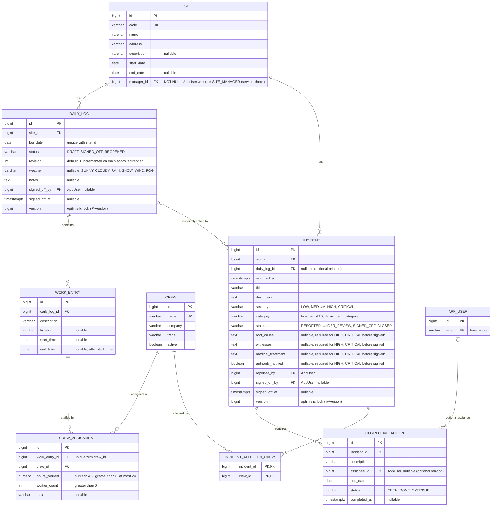
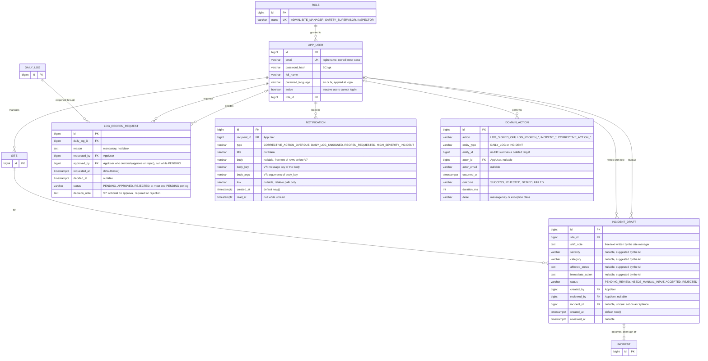
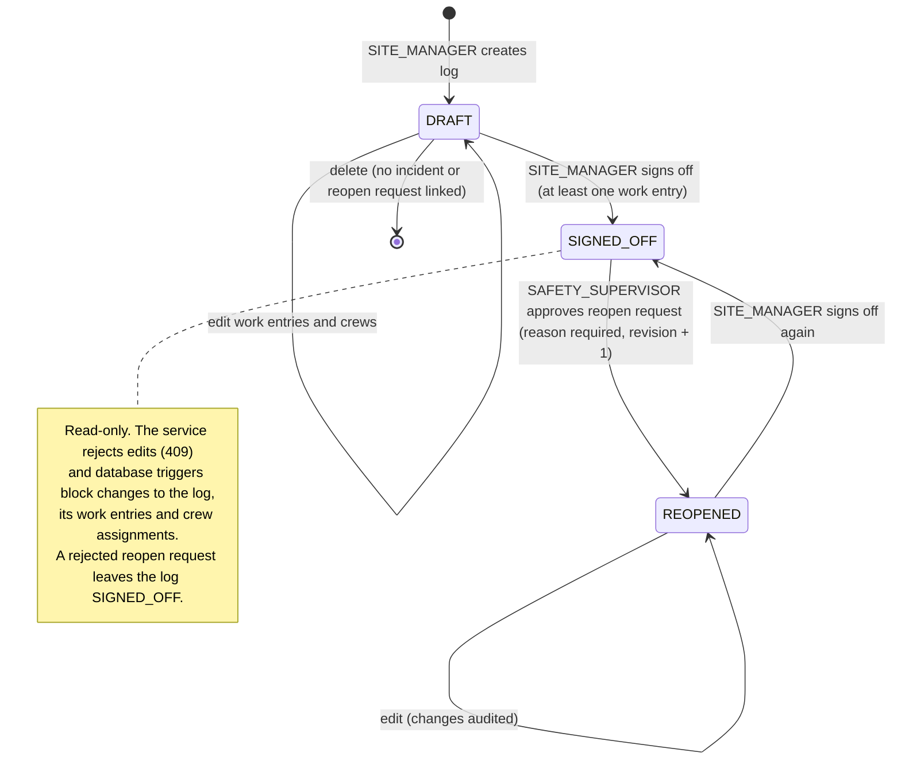
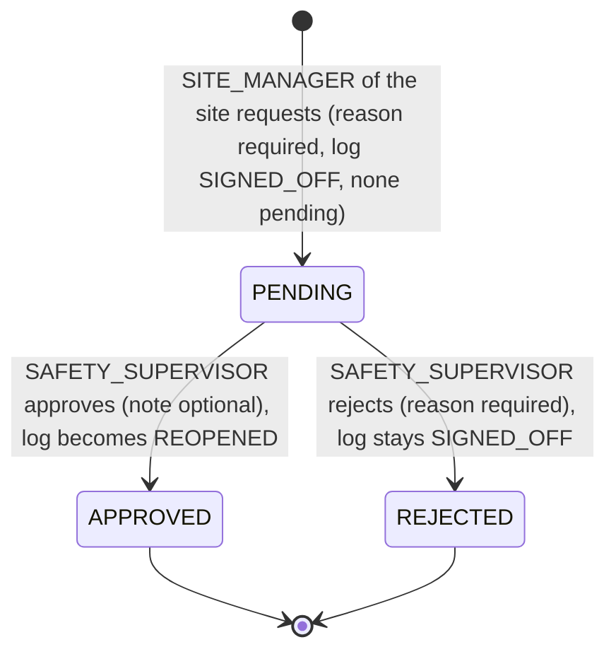
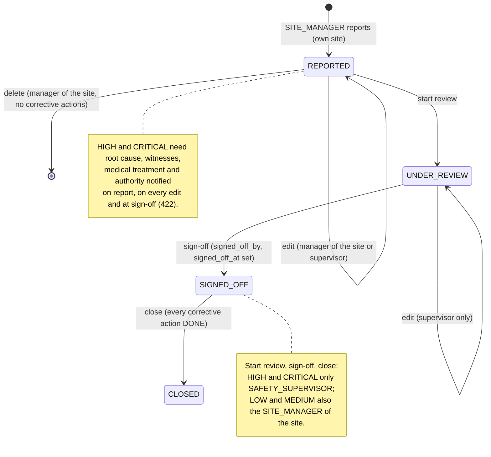
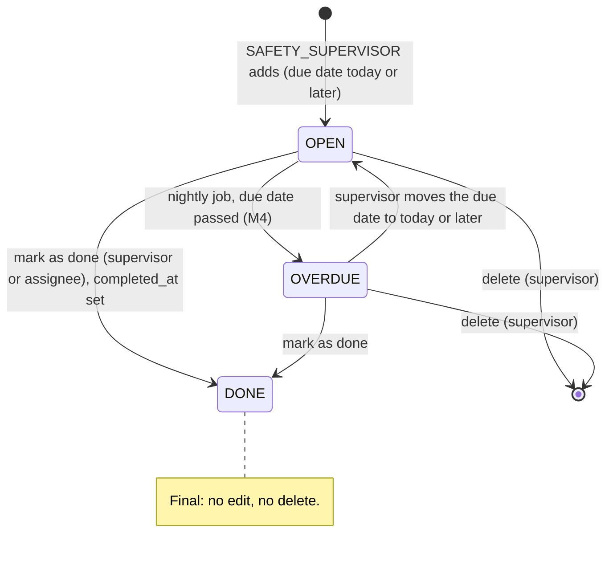
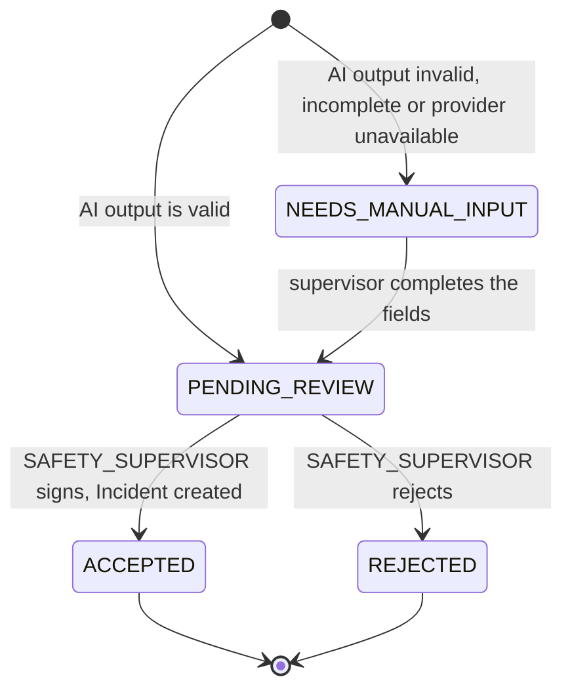

# Domain model

This page is the logical model; the physical schema (every column, constraint, index and
trigger) is in [Database schema](./database.md), and the migrations win if the two disagree. The
reasoning behind the mapping is in [ADR-0001](../adr/0001-persistence-model.md).

Entities in the code (`hr.algebra.sitelog.<feature>.domain`): `Site`, `Crew`, `AppUser`, `Role`,
`DailyLog`, `WorkEntry`, `CrewAssignment`, `LogReopenRequest`, `Incident`, `CorrectiveAction`,
`Notification`, `DomainAction` (`audit.domain`), plus the Envers revision entity
`AuditRevision` (`common.audit`). `IncidentDraft` is a table only.

## Aggregates

| Aggregate root | Owns (cascade, orphan removal) | References (no cascade) |
|---|---|---|
| `DailyLog` | `WorkEntry` → `CrewAssignment` | `Site`, `Crew`, `AppUser` |
| `LogReopenRequest` | — | `DailyLog`, `AppUser` (requester, decider) |
| `Incident` | `CorrectiveAction` | `Site`, `Crew` (affected crews), `DailyLog` (optional), `AppUser` |
| `Site`, `Crew`, `AppUser` | — | `Role` (`AppUser`), `AppUser` (`Site.manager`) |
| `Notification` | — | `AppUser` (recipient) |
| `DomainAction` (append-only, written by the aspect) | — | `AppUser` (actor, optional); the target record by type + id, without foreign key |
| `IncidentDraft` (table only, entity in M3) | — | `Site`, `AppUser`, `Incident` (after acceptance) |

`LogReopenRequest` is deliberately **not** cascaded from `DailyLog`: requests are history and must
not disappear with an edit of the log. A log that has a reopen request can therefore not be
deleted (see [Delete rules](#delete-rules)).

The assignment's chain *Site → DailyLog → WorkEntry → Crew* and *Site → Incident →
CorrectiveAction* is covered by these aggregates. `Site` is the parent in the UI and in the
REST URLs; `DailyLog` and `Incident` carry the `@Version` column and are the units that lock.

## Entity diagram — logs and incidents

Required relation types:

- **One-to-many:** `Site` → `DailyLog` → `WorkEntry`; `Site` → `Incident` → `CorrectiveAction`.
- **Many-to-many with an association entity carrying attributes:** `WorkEntry` ↔ `Crew`
  through `CrewAssignment` (`hours_worked`, `worker_count`, `task`).
- **Many-to-many without attributes:** `Incident` ↔ `Crew` (affected crews), plain join table.
- **Optional relations:** `Incident` → `DailyLog` (0..1), `CorrectiveAction` → `AppUser`
  assignee (0..1).



## Entity diagram — users, reopen requests and AI drafts



Entities repeated with only `id` are fully described in the first diagram. `DOMAIN_ACTION` has
no relation line to `DAILY_LOG` or `INCIDENT` because `entity_id` has no foreign key.

### Mapping notes

- Every association is `FetchType.LAZY`, including `@ManyToOne` (whose JPA default is
  `EAGER`). Screens that need children load them with a fetch join or `@EntityGraph`.
- Every entity extends `BaseEntity` (`common.domain`): identity key, equality by class and id,
  constant `hashCode` per class, so an entity stays findable in a `Set` before and after it gets
  its id.
- **Child collections are ordered `Set`s, not `List`s.** `DailyLog.workEntries`
  (`@OrderBy("startTime ASC, id ASC")`), `WorkEntry.assignments` (`@OrderBy("id ASC")`),
  `Incident.correctiveActions` (`@OrderBy("dueDate ASC, id ASC")`) and `Incident.affectedCrews`
  (`@OrderBy("name ASC")`). The detail query join-fetches two levels at once; with `List`s
  ("bags") Hibernate either throws `MultipleBagFetchException` or repeats each work entry once
  per crew row. With `@OrderBy` Hibernate uses an ordered set, so the screen order is stable.
- Both sides of a parent–child relation are kept in sync by the parent
  (`DailyLog.addWorkEntry/removeWorkEntry`, `WorkEntry.addAssignment/removeAssignment`,
  `Incident.addCorrectiveAction/removeCorrectiveAction`); the getters return read-only views.
  Removing a child from the collection deletes it on flush (`orphanRemoval = true`).
- `CrewAssignment` is a full entity with its own `id` and a unique constraint on
  `(work_entry_id, crew_id)`, not a `@ManyToMany`, because it carries attributes.
- `Incident` ↔ `Crew` is a plain `@ManyToMany` over `incident_affected_crew`.
- `DailyLog.version` and `Incident.version` are `@Version` columns: a stale update fails
  and the API answers **409 Conflict**. Changing only a child (`WorkEntry`,
  `CrewAssignment`, `CorrectiveAction`) does not increment the root's version in Hibernate,
  so services that change a child load the root with `LockModeType.OPTIMISTIC_FORCE_INCREMENT`
  (see [ADR-0001](../adr/0001-persistence-model.md), decision 6).
- A signed-off log is protected in the database by triggers on `daily_log`, `work_entry` and
  `crew_assignment` (migration `V3`). The child triggers check the **parent** log's status:
  `INSERT`, `UPDATE` and `DELETE` on `work_entry` / `crew_assignment` fail when the owning
  `daily_log.status` is `SIGNED_OFF`, and are allowed in `DRAFT` and `REOPENED`. On a
  `SIGNED_OFF` `daily_log` row the only accepted change is the reopen (`REOPENED`,
  `revision` + 1, content unchanged); `DELETE` fails. Details in
  [Database schema](./database.md#locked-daily-logs).
- `DailyLog`, `WorkEntry` and `CrewAssignment` are `@Audited` (Envers, mapped in M2). Their
  references to reference data (`Site`, `Crew`, `AppUser`) are
  `@Audited(targetAuditMode = NOT_AUDITED)`: the audit row keeps the foreign key value only.
- An `IncidentDraft` never writes to `incident` by itself; an `Incident` is created only
  when a supervisor accepts the draft (see [Incident draft](#incident-draft-ai-output)).

## Business rules (confirmed 2026-11-08)

Checked by the services before anything is written; a field rule answers on the form field, a
workflow rule with a flash message.

| Rule | Where it is checked |
|---|---|
| A site is **Finished** when `end_date` is set and `end_date <= today`; otherwise it is **Active** (a future end date is only planned). There is no status column. | `SiteService.isFinished`, and the same condition in the `Active` / `Finished` filter query of the sites list (`SiteRepository.searchByStatusWithManager`). |
| A daily log's date cannot be in the future. | `DailyLogService` (field error on *Date*). |
| One daily log per site and day. | `DailyLogService`, backed by `uk_daily_log_site_date`. |
| Sign-off needs **at least one work entry**. | `DailyLogService.signOff` (flash error). |
| A signed-off log and its children are read-only. | `DailyLogRules.requireEditable`, backed by the V3 triggers. |
| The form must carry the version the user saw; a different version is a conflict (409). | `DailyLogRules.requireVersion`, plus `@Version` at commit. |
| An **inactive crew** is not offered and is rejected for a new crew row, but stays on the logs where it was already assigned (and stays selectable on that row when such a log is edited). | `CrewService.optionsIncluding`, `DailyLogAssembler.resolveCrew`. |
| A site's manager must be an active user with role `SITE_MANAGER`. | `SiteService` (field error on *Site manager*). |

"Today" is taken from one `Clock` bean in the sites' time zone (`sitelog.time-zone:
Europe/Zagreb`), not the server's (Render runs in UTC).

## Delete rules

Decided on 2026-11-07. Records that other records point to are kept, because logs and incidents are
evidence. The service checks first and answers with a flash message; the foreign keys (no
`ON DELETE CASCADE`) stop anything the service missed.

| Entity | Can be deleted when | Otherwise |
|---|---|---|
| `Site` | It has no daily logs, no incidents and no AI incident drafts. | Refused; the message asks to set an *End date* instead (the site then shows as Finished). |
| `DailyLog` | Its status is `DRAFT` and no incident or reopen request points to it. Its work entries and crew rows are deleted with it (cascade from the aggregate root). | Refused with a message. A `SIGNED_OFF` log is also blocked by the lock trigger. |
| `WorkEntry`, `CrewAssignment` | The parent log is editable (`DRAFT` or `REOPENED`). | Refused (log locked). |
| `Crew` | It is not used in any crew assignment and is not an affected crew of any incident. | Refused; the message suggests deactivating it (`active = false` removes it from the selection lists). |

## Notifications

`Notification` (V6) is an in-app message for one user, shown under the bell in the top bar
until it is read (`read_at` set). M2 has the bell (unread counter and newest 10 unread), the
list page and *mark as read* / *mark all as read* / *open*; only the recipient sees or reads it.

| Type | Created when | Recipients | Status |
|---|---|---|---|
| `REOPEN_REQUESTED` | A site manager requests a reopen | Every active `SAFETY_SUPERVISOR` | M3 week 10 |
| `HIGH_SEVERITY_INCIDENT` | An incident is reported as `HIGH` / `CRITICAL`, or raised to it by an edit | Every active `SAFETY_SUPERVISOR` | M3 week 10 |
| `CORRECTIVE_ACTION_OVERDUE` | Nightly job | Assignee | M4 |
| `DAILY_LOG_UNSIGNED` | Nightly job | Site manager | M4 |

**Decision (2026-11-08): store a message key and arguments, not finished text.** The title is
the key `notification.type.<TYPE>`, the body is `body_key` + `body_args` (V7), and both are
rendered in the reader's language, so the same notification reads correctly in English and
Croatian. V6 was not edited; V7 added the two columns.

## Decision — reopen audit trail (AR1)

Advanced requirement 1 asks for an audited reopen: while a log is `REOPENED`, each change must
record the value before and after, who changed it and when. `LOG_REOPEN_REQUEST` records the
reopen itself (reason, requester, approver), not the field changes. Two options:

**(a) Hibernate Envers.** `@Audited` on `DailyLog`, `WorkEntry` and `CrewAssignment`; Envers
writes `*_AUD` tables, and a custom `REVINFO` entity (with a `RevisionListener`) adds the user.

- Pros: little code; whole-entity history; queryable with `AuditReader`; standard and easy to
  name in the defence.
- Cons: audits every change, also in `DRAFT`, unless filtered; `*_AUD` tables still need
  Flyway migrations (`ddl-auto=validate`); "before/after" per field must be computed by
  comparing revisions; one more dependency.

**(b) Own table `DAILY_LOG_AUDIT`** (proposal, not in the diagrams above):

```text
DAILY_LOG_AUDIT (proposed)
  id            bigint PK
  daily_log_id  bigint FK -> DAILY_LOG
  revision      int        -- DAILY_LOG.revision at the time of the change
  entity        varchar    -- DAILY_LOG, WORK_ENTRY, CREW_ASSIGNMENT
  entity_id     bigint
  field         varchar
  old_value     text
  new_value     text
  changed_by    bigint FK -> APP_USER
  changed_at    timestamptz
```

- Pros: written only for edits in `REOPENED`; one row per field gives before/after directly;
  simple to show on screen and in the report; full control in plain SQL.
- Cons: the service must write each row (risk of missing a field); more code and tests; values
  stored as text.

**Decision (2026-10-31): (a) Hibernate Envers**, recorded in ADR-0003. The Envers mapping is in
place since M2 (`@Audited` on the aggregate, revision entity `AuditRevision` with
`AuditRevisionListener`); the reopen workflow and the before/after history page since M3 week 10.

- Reopen edits touch the children (`WorkEntry`, `CrewAssignment`), including deletions. Envers
  records inserts, updates and deletes on every `@Audited` entity without per-field service code,
  which is where a hand-written trail (option b) would most likely miss a change.
- Before/after is obtained by comparing two revisions with `AuditReader`; a `RevisionListener`
  stores the authenticated user on the custom revision entity.
- The `*_aud` tables and the revision table (`revinfo`) are created by Flyway (`V3`), so the
  audit schema is explicit and validated like the rest (`ddl-auto=validate`); `V5` makes them
  append-only ([Database schema](./database.md#audit-tables-envers)).
- The audit works in three layers: `LOG_REOPEN_REQUEST` (why and who decided), the domain
  aspect writing `DOMAIN_ACTION` (which action happened, by whom, with which outcome) and Envers
  (what changed in the data). All three are implemented since M3 week 10
  ([Architecture — AR1](./overview.md#11-ar1-audited-reopen)).

## Roles and capabilities

Confirmed on 2026-11-24. Target capabilities of each role; the AI draft and the compliance
report get their implementation in M3 week 11 and M4.

| Role | Can | Cannot |
|---|---|---|
| `ADMIN` | Manage sites, crews and users (users are only deactivated, never deleted). Read everything. | Write daily logs, reopen requests, incidents or corrective actions. |
| `SITE_MANAGER` | On the sites they manage: create, edit and delete daily logs, work entries and crew rows; sign off a log; request a reopen (with reason); report incidents; edit an own-site incident while `REPORTED`; start review, sign off and close `LOW` / `MEDIUM` incidents of the own site; delete a `REPORTED` incident without corrective actions; write shift notes for the AI draft (M3 week 11). Mark as done a corrective action assigned to them. Read every site. | Edit a signed-off log; approve or reject a reopen; move a `HIGH` / `CRITICAL` incident through the workflow or lower its severity; manage corrective actions; accept AI drafts. |
| `SAFETY_SUPERVISOR` | On every site: approve or reject reopen requests (own queue); start review, sign off and close incidents of any severity (only role for `HIGH` / `CRITICAL`); edit incidents while `REPORTED` or `UNDER_REVIEW`, including lowering a `HIGH` / `CRITICAL` severity; create, edit, assign, mark as done and delete corrective actions; review and accept AI drafts (M3 week 11). Read everything. | Manage users, sites and crews; write daily logs; report incidents. |
| `INSPECTOR` | Read logs, incidents, revision history; view the compliance report (M4). | Any write operation. |

Authorization is enforced on service methods (`@PreAuthorize`), and the Thymeleaf security
dialect hides actions the current user cannot perform. Hiding is cosmetic; the service check is
the rule, for the screens and the REST API alike. How the checks are wired:
[Architecture overview — Security](./overview.md#8-security).

### Permissions

Confirmed on 2026-11-24 (state after M3 week 10). "Own site" means `site.manager_id` is the
signed-in user (checked by `SiteAccess` and `IncidentAccess`). **Read** = list and detail pages,
the `GET` endpoints of the API and the read methods of the services, which require only a
signed-in user.

| Operation | `ADMIN` | `SITE_MANAGER` | `SAFETY_SUPERVISOR` | `INSPECTOR` |
|---|---|---|---|---|
| Read sites, daily logs, work entries, crew rows, crews, incidents, corrective actions, reopen requests of a log, revision history | yes | yes, every site | yes | yes |
| Create, edit, delete a site; choose its manager | yes | no | no | no |
| Create, edit, deactivate, delete a crew | yes | no | no | no |
| Create, edit, delete a daily log (draft or reopened); open the *New daily log* form | no | own sites only | no | no |
| Add, edit, remove work entries and crew rows | no | own sites only | no | no |
| Sign off a daily log | no | own sites only | no | no |
| Request a reopen | no | own sites only | no | no |
| Approve or reject a reopen; see the pending queue (`/reopen-requests`) | no | no | yes | no |
| Report an incident | no | own sites only | no | no |
| Edit an incident | no | own sites, only while `REPORTED` | yes, while `REPORTED` or `UNDER_REVIEW` | no |
| Lower the severity of a `HIGH` / `CRITICAL` incident | no | no | yes | no |
| Start review, sign off, close an incident | no | own sites, `LOW` / `MEDIUM` only | yes, any severity | no |
| Delete an incident (`REPORTED`, no corrective actions) | no | own sites only | no | no |
| Create, edit, delete a corrective action | no | no | yes | no |
| Mark a corrective action as done | no | if they are its assignee | yes | no |
| List, create and edit users; activate / deactivate; assign sites | yes | no | no | no |
| Own profile: name, preferred language, password | yes | yes | yes | yes |
| Own notifications: read, mark as read | yes | yes | yes | yes |

A refused call throws `AccessDeniedException` before the method body runs; the screen answers
with the 403 page, the API with a 403 `ProblemDetail`. An id that does not exist answers 404,
not 403 (`SiteAccess` and `IncidentAccess` let the call through and the service throws its
not-found exception). `RoleAccessMatrixTests` calls representative endpoints of these rows
(pages, and POSTs with a valid CSRF token and body) as each of the five demo users and
anonymously, and expects success for the allowed users and 403 for everyone else; the API
controller tests check the 403 of the API per role.

### Reopen requests

Confirmed on 2026-11-24 (AR1). Implemented in `LogReopenService`.

| Rule | Where it is checked |
|---|---|
| Only a `SIGNED_OFF` log can be reopened, and the request carries the version the user saw. | `LogReopenService.request` (409 otherwise). |
| The reason is mandatory. | Service (field error / 422), `ck_log_reopen_request_reason`. |
| At most one `PENDING` request per log. | Service (409), `uk_log_reopen_request_pending`. |
| Every active safety supervisor is notified. | `NotificationPublisher.notifyRole` (`REOPEN_REQUESTED`). |
| Approval: the request becomes `APPROVED`, the log `REOPENED` with `revision` + 1; the note is optional. | `LogReopenService.approve`; the V3 trigger accepts exactly this change on a `SIGNED_OFF` row. |
| Rejection needs a reason; the log stays `SIGNED_OFF`. | `LogReopenService.reject`, `ck_log_reopen_request_decision_note` (V7). |
| A request is decided once. Two supervisors deciding at the same moment: the second waits for the first, then gets 409. | `SELECT ... FOR UPDATE` on the request (`findForDecisionById`), status check after the lock. |
| A concurrent change of the log while it is being reopened is a conflict. | `DailyLog.@Version` (409). |
| A reopened log is edited and signed off again like a draft; every change is in the revision history. | `DailyLogService`, Envers, `DailyLogHistoryService`. |

### Incidents and corrective actions

Confirmed on 2026-11-24 (AR2). Implemented in `IncidentService` and `CorrectiveActionService`.

| Rule | Where it is checked |
|---|---|
| `HIGH` / `CRITICAL` need root cause, witnesses, medical treatment and authority notified: on report, on every edit and again at sign-off. Blank text counts as missing. | `IncidentRules.missingSeverityFields` → `MissingSeverityFieldsException` (422 with every missing field); `ck_incident_severity_fields` (V3) as the database safety net for `SIGNED_OFF` / `CLOSED`. |
| `HIGH` / `CRITICAL` are moved through the workflow (start review, sign-off, close) only by a safety supervisor. | `@PreAuthorize` with `@incidentAccess.isLowSeverityOnOwnSite`, repeated on the loaded record in the service. |
| Only a safety supervisor may lower a `HIGH` / `CRITICAL` severity (otherwise a manager could downgrade and sign it himself). | `IncidentService.update` (field error on *Severity*). |
| Raising an incident to `HIGH` / `CRITICAL`, or reporting it as such, notifies every active safety supervisor. | `NotificationPublisher` (`HIGH_SEVERITY_INCIDENT`). |
| Edit: site manager only while `REPORTED`; supervisor while `REPORTED` or `UNDER_REVIEW`; no edit after sign-off. | `IncidentService.update` (409). |
| Delete: only a `REPORTED` incident without corrective actions. | `IncidentService.delete` (409). |
| Close: only `SIGNED_OFF`, and only when every corrective action is `DONE`. | `IncidentService.close` (409). |
| The incident date cannot be in the future; the optional daily log must belong to the same site; a newly added affected crew must be active. | `IncidentService` (field errors / 422). |
| Corrective actions: not on a `CLOSED` incident; due date not in the past (an unchanged past date of an overdue action may stay); the assignee is optional and must be an active `SITE_MANAGER` or `SAFETY_SUPERVISOR`; a `DONE` action is final (no edit, no delete). | `CorrectiveActionService` (field errors / 422, 409). |
| *Mark as done* by a supervisor or by the action's assignee; `completed_at` is set. | `@PreAuthorize` with `@incidentAccess.isAssignee`; `ck_corrective_action_completed`. |
| `OPEN` → `OVERDUE` is set by the nightly job (M4), not on read. Moving the due date of an `OVERDUE` action to today or later makes it `OPEN` again. | M4 job; `CorrectiveActionService.update`. |
| Every change sends the version the user saw; a corrective action change bumps the incident's version. | `IncidentRules.requireVersion`, `OPTIMISTIC_FORCE_INCREMENT` on the incident (409). |

### User accounts

| Rule | Where it is checked |
|---|---|
| The login is the e-mail, unique ignoring case. | `AppUserDetailsService` (case-insensitive lookup), `UserService` (field error on *E-mail*); `uk_app_user_email` + `ck_app_user_email_lower` (stored lower-case). |
| An inactive user cannot sign in. The login page shows the same message as for a wrong password, so it does not reveal which e-mails exist. | `AppUserPrincipal.isEnabled()` → Spring Security's authentication provider. |
| Users are never deleted, only deactivated: daily logs, incidents and audit rows point to them (confirmed 2026-11-24). | `UserService` has no delete operation. |
| An admin cannot deactivate their own account or change their own role. | `UserService.update` / `setActive`. |
| Every site has exactly one manager, an active `SITE_MANAGER`. A site leaves a manager only by being assigned to another one, so a user who still manages sites keeps the `SITE_MANAGER` role. | `UserService.assignSites` and `update`, `SiteService`; `site.manager_id NOT NULL`. |
| Password: at least 12 characters and at most 72 bytes (BCrypt uses only the first 72 bytes). A change needs the current password and a matching confirmation, and must differ from the current one. Stored only as a BCrypt hash. | `PasswordPolicy` (service, also for the future API), `@PasswordLength` on the forms (one message per field). |
| The preferred language (`en` / `hr`) becomes the UI language at login. | `PreferredLanguageLoginSuccessHandler` (`lang` cookie). |

## State machines

### Daily log (advanced requirement 1)



### Reopen request (advanced requirement 1)



### Incident (advanced requirement 2)

Values of `IncidentStatus`. Who may perform each step is in [Permissions](#permissions).



How an accepted AI draft enters this workflow is defined with the AI feature (M3 week 11).

### Corrective action

Values of `CorrectiveActionStatus`.



No change on a `CLOSED` incident.

### Incident draft (AI output)


