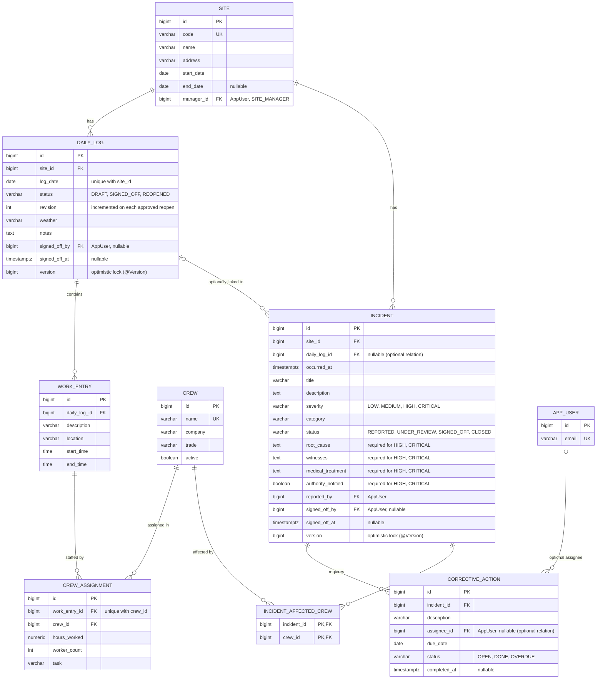
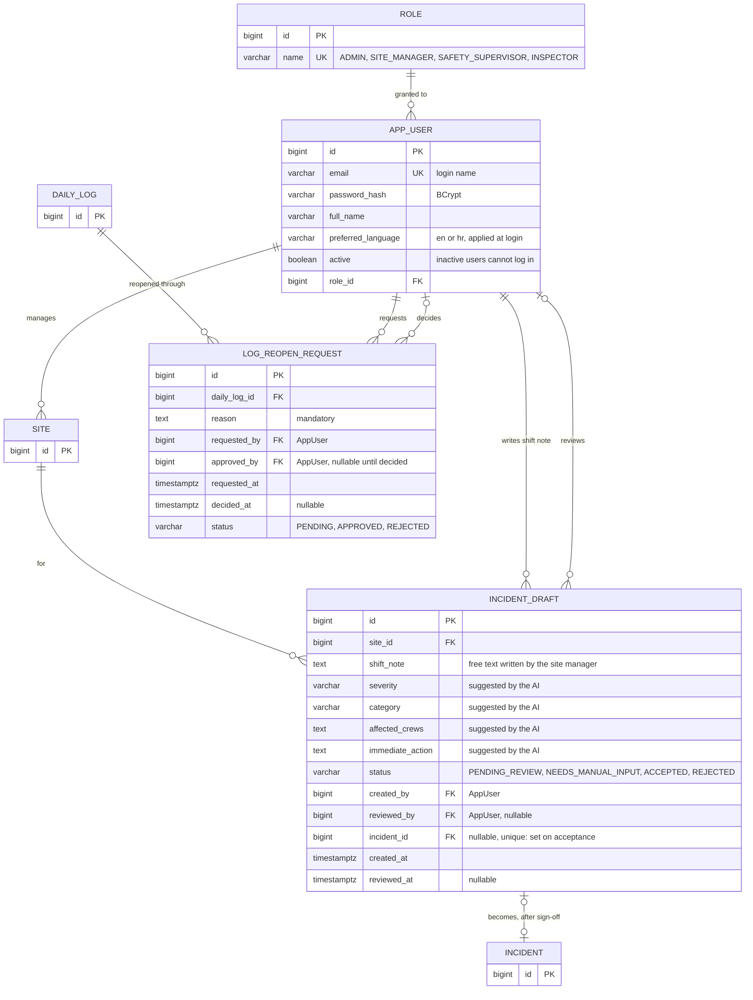
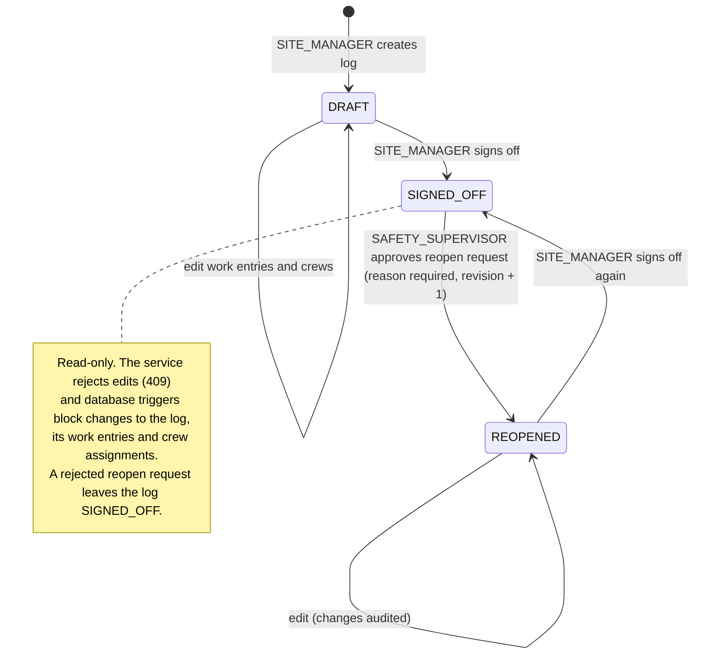
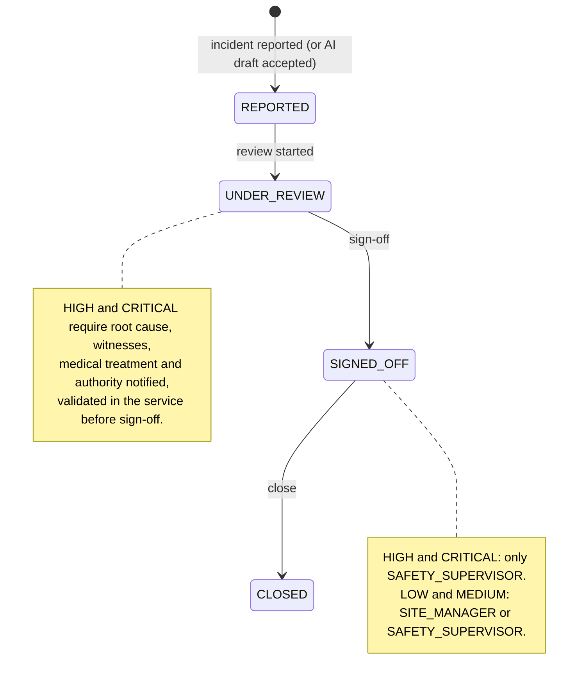
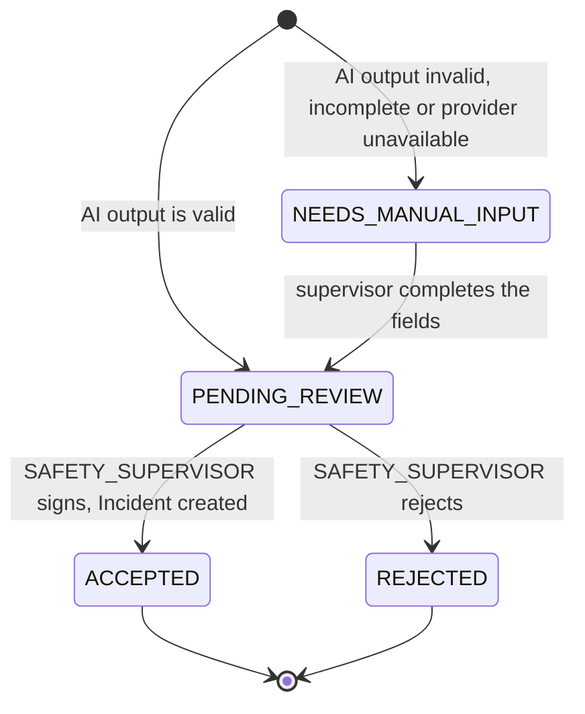

# Domain model

:::info Status
Model accepted on 2026-10-31 (milestone M1). The tables are created by Flyway migrations in
milestone M2; when they land, this page is updated to match the migrations exactly
(column names, types, constraints). The reasoning behind the mapping is in
[ADR-0001](../adr/0001-persistence-model.md).
:::

## Aggregates

| Aggregate root | Owns (cascade, orphan removal) | References (no cascade) |
|---|---|---|
| `DailyLog` | `WorkEntry` → `CrewAssignment`, `LogReopenRequest` | `Site`, `Crew`, `AppUser` |
| `Incident` | `CorrectiveAction` | `Site`, `Crew` (affected crews), `DailyLog` (optional), `AppUser` |
| `Site`, `Crew`, `AppUser` | — | `Role` |
| `IncidentDraft` | — | `Site`, `AppUser`, `Incident` (after acceptance) |

The assignment's chain *Site → DailyLog → WorkEntry → Crew* and *Site → Incident →
CorrectiveAction* is covered by these aggregates. `Site` is the parent in the UI and in the
REST URLs; `DailyLog` and `Incident` carry the `@Version` column and are the units that lock.

## Entity diagram — logs and incidents

Required relation types:

- **One-to-many:** `Site` → `DailyLog` → `WorkEntry`; `Site` → `Incident` → `CorrectiveAction`.
- **Many-to-many with an association entity carrying attributes:** `WorkEntry` ↔ `Crew`
  through `CrewAssignment` (`hours_worked`, `worker_count`, `task`).
- **Many-to-many without attributes:** `Incident` ↔ `Crew` (affected crews), plain join table.
- **Optional relations:** `Incident` → `DailyLog` (0..1), `CorrectiveAction` → `AppUser`
  assignee (0..1).



## Entity diagram — users, reopen requests and AI drafts



Entities repeated with only `id` are fully described in the first diagram.

### Mapping notes

- Every association is `FetchType.LAZY`, including `@ManyToOne` (whose JPA default is
  `EAGER`). Screens that need children load them with a fetch join or `@EntityGraph`.
- `CrewAssignment` is a full entity with its own `id` and a unique constraint on
  `(work_entry_id, crew_id)`, not a `@ManyToMany`, because it carries attributes.
- `Incident` ↔ `Crew` is a plain `@ManyToMany` over `incident_affected_crew`.
- `DailyLog.version` and `Incident.version` are `@Version` columns: a stale update fails
  and the API answers **409 Conflict**. Changing only a child (`WorkEntry`,
  `CrewAssignment`, `CorrectiveAction`) does not increment the root's version in Hibernate,
  so services that change a child load the root with `LockModeType.OPTIMISTIC_FORCE_INCREMENT`
  (see [ADR-0001](../adr/0001-persistence-model.md), decision 6).
- A signed-off log is protected in the database by triggers on `daily_log`, `work_entry` and
  `crew_assignment`. The child triggers check the **parent** log's status: `INSERT`, `UPDATE`
  and `DELETE` on `work_entry` / `crew_assignment` fail when the owning `daily_log.status` is
  `SIGNED_OFF`, and are allowed in `DRAFT` and `REOPENED`. Planned for the M2 migrations.
- An `IncidentDraft` never writes to `incident` by itself; an `Incident` is created only
  when a supervisor accepts the draft (see [Incident draft](#incident-draft-ai-output)).

## Decision — reopen audit trail (AR1)

Advanced requirement 1 asks for an audited reopen: while a log is `REOPENED`, each change must
record the value before and after, who changed it and when. `LOG_REOPEN_REQUEST` records the
reopen itself (reason, requester, approver), not the field changes. Two options:

**(a) Hibernate Envers.** `@Audited` on `DailyLog`, `WorkEntry` and `CrewAssignment`; Envers
writes `*_AUD` tables, and a custom `REVINFO` entity (with a `RevisionListener`) adds the user.

- Pros: little code; whole-entity history; queryable with `AuditReader`; standard and easy to
  name in the defence.
- Cons: audits every change, also in `DRAFT`, unless filtered; `*_AUD` tables still need
  Flyway migrations (`ddl-auto=validate`); "before/after" per field must be computed by
  comparing revisions; one more dependency.

**(b) Own table `DAILY_LOG_AUDIT`** (proposal, not in the diagrams above):

```text
DAILY_LOG_AUDIT (proposed)
  id            bigint PK
  daily_log_id  bigint FK -> DAILY_LOG
  revision      int        -- DAILY_LOG.revision at the time of the change
  entity        varchar    -- DAILY_LOG, WORK_ENTRY, CREW_ASSIGNMENT
  entity_id     bigint
  field         varchar
  old_value     text
  new_value     text
  changed_by    bigint FK -> APP_USER
  changed_at    timestamptz
```

- Pros: written only for edits in `REOPENED`; one row per field gives before/after directly;
  simple to show on screen and in the report; full control in plain SQL.
- Cons: the service must write each row (risk of missing a field); more code and tests; values
  stored as text.

**Decision (2026-10-31): (a) Hibernate Envers**, recorded in ADR-0003 (M2).

- Reopen edits touch the children (`WorkEntry`, `CrewAssignment`), including deletions. Envers
  records inserts, updates and deletes on every `@Audited` entity without per-field service code,
  which is where a hand-written trail (option b) would most likely miss a change.
- Before/after is obtained by comparing two revisions with `AuditReader`; a `RevisionListener`
  stores the authenticated user on the custom revision entity.
- The `*_AUD` tables and the revision table are created by Flyway migrations, so the audit schema
  is explicit and validated like the rest (`ddl-auto=validate`).
- The audit works in three layers: `LOG_REOPEN_REQUEST` (why and who approved), a domain
  `@Aspect` (which action happened — sign-off, reopen, incident transitions) and Envers (what
  changed in the data).

## Roles and capabilities

| Role | Can | Cannot |
|---|---|---|
| `ADMIN` | Manage sites, crews and users. | Sign off logs or incidents. |
| `SITE_MANAGER` | Create, edit and delete daily logs and work entries of the sites they manage; sign off a log; request a reopen (with reason); write shift notes for the AI draft; report incidents; sign off `LOW` / `MEDIUM` incidents. | Edit a signed-off log; approve a reopen; sign off `HIGH` / `CRITICAL` incidents; accept AI drafts. |
| `SAFETY_SUPERVISOR` | Review, edit and accept or reject AI drafts; sign off incidents of any severity (only role allowed for `HIGH` / `CRITICAL`); approve or reject reopen requests; manage corrective actions. | Manage users, sites and crews. |
| `INSPECTOR` | Read logs and incidents; view the compliance report. | Any write operation. |

Authorization is enforced on service methods (`@PreAuthorize`), and the Thymeleaf security
dialect hides actions the current user cannot perform.

## State machines

### Daily log (advanced requirement 1)



### Incident (advanced requirement 2)



### Incident draft (AI output)


