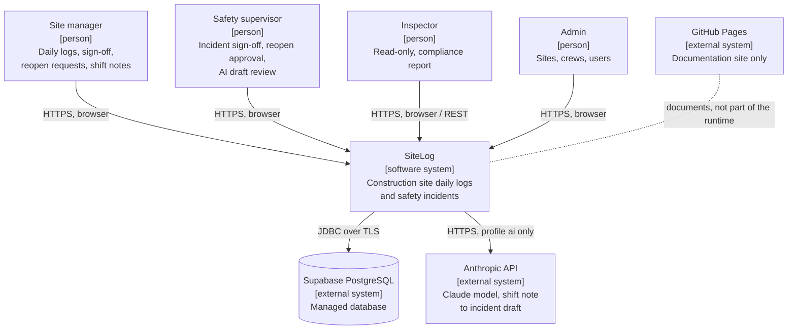
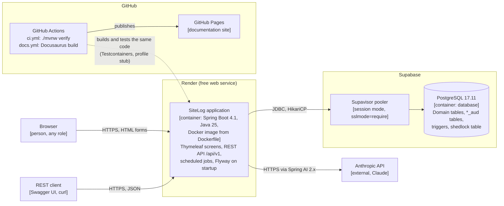
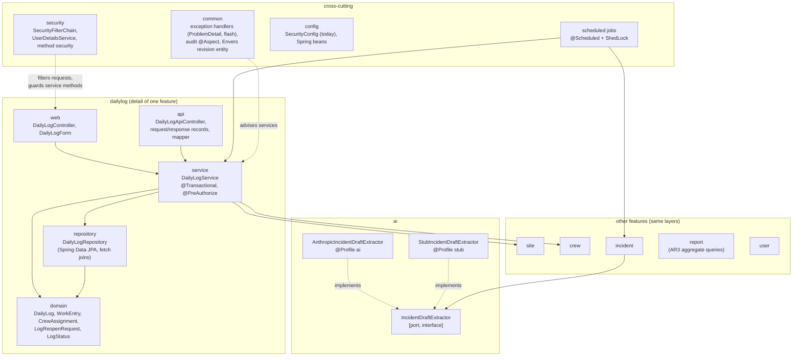
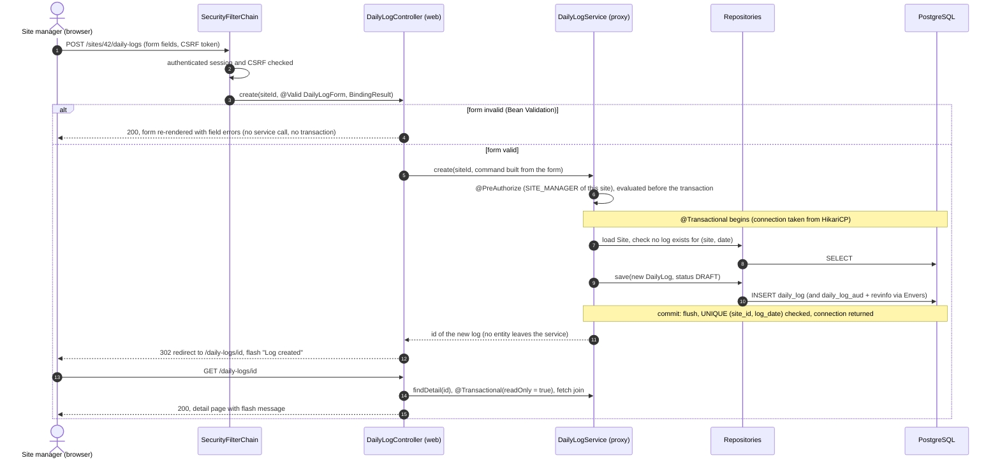
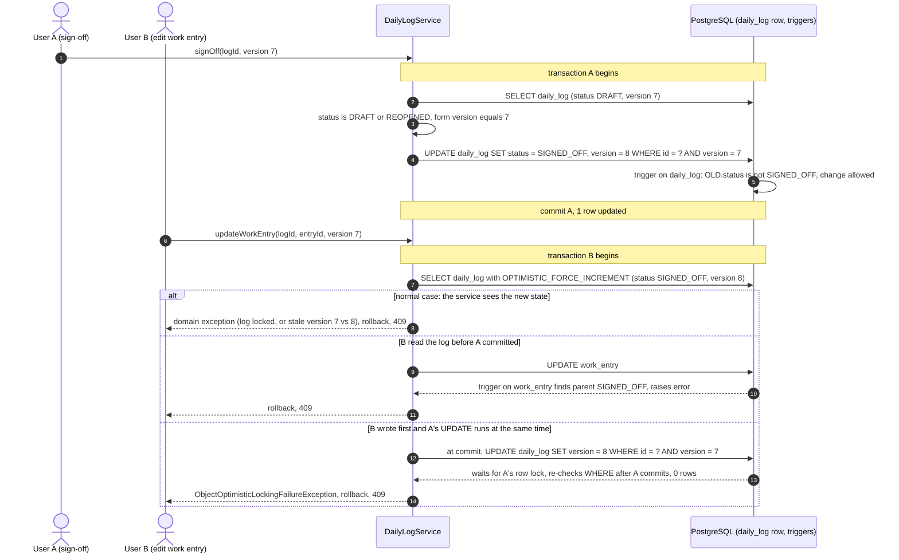
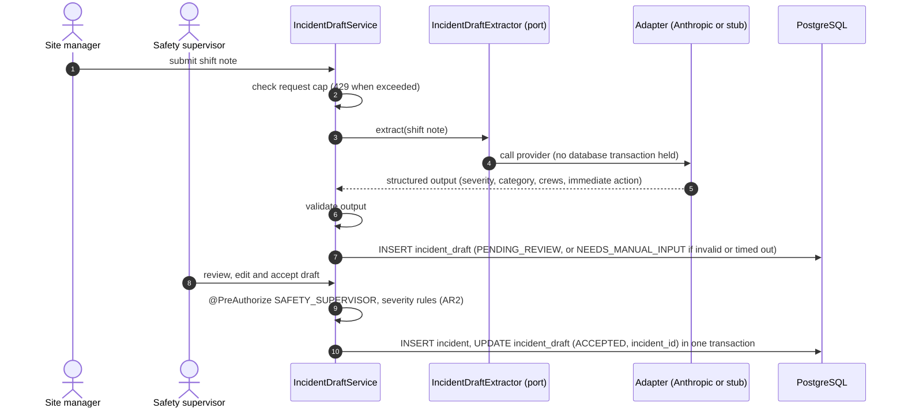

# Architecture overview

:::info Status (2026-11-04, milestone M2)
Written before the domain code. **Implemented** today: the M1 skeleton —
`SiteLogApplication`, `config/SecurityConfig` (temporary form login, public health check),
Flyway `V1__baseline.sql`, `ddl-auto=validate`, `open-in-view=false`, the `dev` profile and
Testcontainers integration tests — plus, from M2, the database: migrations `V2`–`V5` (tables,
constraints, lock triggers, append-only audit tables, demo data). Everything else on this page is the **planned** design;
each section names the milestone that delivers it. The domain is described in the
[domain model](./domain-model.md); persistence choices in
[ADR-0001](../adr/0001-persistence-model.md); the reopen audit trail in
[ADR-0003](../adr/0003-reopen-audit-trail.md); the physical schema created by the Flyway
migrations `V2`–`V5` in [Database schema](./database.md).
:::

## 1. System context

Who uses SiteLog and which external systems it depends on. Diagrams use Mermaid flowcharts
in the C4 style (Mermaid's native C4 syntax is experimental).

| Element | Status |
|---|---|
| Four roles | Planned for M3 (Spring Security with real users). Today: one generated default user. |
| Supabase PostgreSQL | Chosen in M1 ([ADR-0001](../adr/0001-persistence-model.md)); first deployment in M3. |
| Anthropic API | Chosen in M1; AI feature in M3 (ADR-0002). Called only when profile `ai` is active. |
| GitHub Pages | Implemented: `docs.yml` publishes this site. It is not the application deployment. |

## 2. Containers

| Container | Technology | Status |
|---|---|---|
| SiteLog application | Spring Boot 4.1 jar in a Docker image on Render | Skeleton runs locally (M1). Dockerfile and Render deployment: M3. |
| Database | PostgreSQL 17 — `postgres:17-alpine` locally and in tests, Supabase 17.11 in production | Local + tests implemented (M1). Domain schema: implemented, migrations `V2`–`V5` ([Database schema](./database.md)). Supabase: M3. |
| AI provider | Anthropic Claude through Spring AI 2.x | M3. |
| CI | GitHub Actions `ci.yml` (`./mvnw verify`), `docs.yml` (this site) | Implemented (M1). |

## 3. Components (inside the application)

Base package `hr.algebra.sitelog`, split **by feature**, each feature split **by layer**.

| Package | Responsibility | Status |
|---|---|---|
| `config` | Spring configuration; today the temporary `SecurityConfig`. | Implemented (M1, temporary). |
| `site`, `crew`, `user` | Admin-managed reference data. | M2 (CRUD), `user` with roles in M3. |
| `dailylog` | Aggregate `DailyLog → WorkEntry → CrewAssignment`, sign-off, reopen (AR1). | M2 (CRUD), M3 (lock + audited reopen). |
| `incident` | Aggregate `Incident → CorrectiveAction`, severity workflow (AR2). | M2 (entities), M3 (workflow). |
| `report` | Compliance report per site and period (AR3). | M4. |
| `ai` | Port `IncidentDraftExtractor` and its two adapters; draft review flow. | M3. |
| `security` | Users, roles, `SecurityFilterChain`, method security. Replaces `config/SecurityConfig`. | M3. |
| `common` | Shared exceptions and handlers, audit aspect, Envers revision entity and listener. | M2–M3. |
| Scheduled jobs | Overdue corrective actions, unsigned log reminder; lock strategy in ADR-0004. | M4. |

## 4. Layering rules

| Layer | Contains | May call | Must not |
|---|---|---|---|
| `web` | `@Controller`, form objects (`DailyLogForm`, Bean Validation annotations), view names | its feature's `service` | contain business rules; touch repositories; open transactions; put entities in a form backing object |
| `api` | `@RestController` under `/api/v1/...`, request/response **records**, mappers entity → record | its feature's `service` | return entities; contain business rules |
| `service` | `@Service` classes: business rules, state transitions, authorization (`@PreAuthorize`), transactions (`@Transactional`, `readOnly = true` for reads) | own `repository`, other features' `service`, the AI port | depend on `web`/`api` types (HTTP, `Model`, `RedirectAttributes`) |
| `repository` | Spring Data JPA interfaces; JPQL with fetch joins / `@EntityGraph`; record projections for reports | — | contain business decisions |
| `domain` | JPA entities, enums, domain exceptions; invariants that depend only on the entity's own state | — | depend on Spring MVC or on other layers |

Rules applied everywhere:

- **Constructor injection only** (no field `@Autowired`); a single constructor needs no annotation.
- **Thin controllers:** bind and validate the form → call one service method → redirect
  (POST-Redirect-GET) with a flash message, or re-render the form on validation errors.
- **Forms and DTOs are not entities.** Forms live in `web`, request/response records and their
  mappers in `api`. Mapping happens inside the service transaction or from a fully loaded
  object, because `open-in-view=false` makes lazy loading outside a transaction fail.
- **Domain exceptions → HTTP.** Services throw domain exceptions (for example "log is
  locked", "not found", "invalid transition"). For the REST API a `@RestControllerAdvice`
  turns them into `ProblemDetail` (400 validation, 404 not found, 409 conflict / locked log /
  stale version, 422 business rule, 429 AI request cap). For screens a `@ControllerAdvice`
  (or the controller) turns them into a flash error and a redirect. Exception names are fixed
  when the code exists (M2–M3).
- **Schema only through Flyway**; Hibernate validates (`ddl-auto=validate`). Implemented.

## 5. Profiles

Profiles are combined: one **datasource** profile plus one **AI** profile
(for example `dev,stub`, `prod,ai`). No profile has default credentials; secrets come from the
environment.

| Profile | Datasource | AI adapter | Secrets come from | Status |
|---|---|---|---|---|
| `dev` | PostgreSQL 17 from `docker-compose.yml`, pool size 5 | — (combine with `stub` or `ai`) | git-ignored `.env` (template `.env.example`), read by Docker Compose and by Spring (`spring.config.import`) | Implemented (M1). |
| `test` | Testcontainers `postgres:17-alpine`, connection injected by `@ServiceConnection` | `stub` | none (container credentials are generated) | Testcontainers implemented (M1) without a named profile; `test` profile with the stub adapter in M3. |
| `stub` | — | `StubIncidentDraftExtractor`: deterministic drafts, no network | none | M3. Always used in tests and CI. |
| `ai` | — | `AnthropicIncidentDraftExtractor` via Spring AI 2.x; cheap configurable model, low `max-tokens`, request cap | `ANTHROPIC_API_KEY` environment variable | M3. |
| `prod` | Supabase through the Supavisor pooler, session mode, `sslmode=require`; Flyway migrates on startup | `ai` on Render (`stub` possible if the key is absent) | Render environment variables (datasource URL, user, password, AI key) | M3. |

Exactly one AI adapter bean exists at runtime: activating neither or both of `stub` and `ai`
fails at startup instead of picking a provider silently.

## 6. Request flows

### 6.1 Creating a daily log (screen, POST-Redirect-GET)

- **Transaction boundary:** starts when the call enters the service proxy and ends at commit,
  before the controller builds the redirect. The controller and the view run outside any
  transaction; with `open-in-view=false` they cannot trigger lazy loading.
- **Authorization:** `@PreAuthorize` is checked by the method-security interceptor, which by
  default sits outside the transaction interceptor, so a denied call never opens a transaction.
  A denial returns 403 (screen: error page; API: `ProblemDetail`).
- **Validation in two places:** field format on the form (`@NotNull`, `@Size`, ...); business
  rules (one log per site and day, site must be active) in the service, backed by the database
  constraint.
- **REST variant:** `POST /api/v1/sites/42/daily-logs` with a JSON request record goes to the
  **same** service method. Success answers `201 Created` with a `Location` header and a
  response record; a validation error answers 400 and a domain error its `ProblemDetail`
  status, instead of a re-rendered form or a flash message.

Status: M2 (screens and service), M3 (`@PreAuthorize` with real roles, REST API, Envers).

### 6.2 Signing off a daily log, and two users at the same time

The edit form and the sign-off form both carry the log's `version` as a hidden field.
Below, user A signs off while user B saves a change to a work entry of the same log; both
opened the page at `version = 7`.

- **Who wins:** whichever transaction updates the `daily_log` row first. PostgreSQL row locks
  serialize the two writes; under `READ COMMITTED` the loser's `WHERE version = 7` is
  re-evaluated against the committed row and matches nothing. The second request always ends
  in **409 Conflict** (`ProblemDetail` in the API, flash error plus reload on the screen); no
  update is lost.
- **Why `OPTIMISTIC_FORCE_INCREMENT`:** B changes only a child (`work_entry`). Without the
  forced increment the root's `version` would not change and the conflict with A's sign-off
  could go unnoticed ([ADR-0001](../adr/0001-persistence-model.md), decision 6).
- **Where the triggers act:** last line of defence. The service rejects edits of a
  `SIGNED_OFF` log first (domain exception → 409); the triggers on `daily_log`, `work_entry`
  and `crew_assignment` reject any `INSERT`/`UPDATE`/`DELETE` that reaches the database anyway
  (a bug in the service, a race like the second branch above, or manual SQL). The exact rules
  are in [Database schema — Locked daily logs](./database.md#locked-daily-logs).
- **Reopen** follows the same pattern: a `LogReopenRequest` with a reason; on approval by a
  safety supervisor the log goes to `REOPENED`, `revision` + 1, and the changes made while
  reopened are read back from the Envers revisions
  ([ADR-0003](../adr/0003-reopen-audit-trail.md)).

Status: triggers and `version` columns implemented (migrations `V2`, `V3`); service logic, reopen
and the concurrency test in M3–M4.

### 6.3 Shift note → AI draft → supervisor review

The AI never writes an `Incident`. The provider call happens before the transaction that saves
the draft, so a slow provider does not hold a database connection. Status: M3 (details in
ADR-0002 and `docs/ai-evaluation.md`).

## 7. Cross-cutting concerns

| Concern | Design | Status |
|---|---|---|
| **Security** | Form login with users from the database (BCrypt), four roles. URL rules in the `SecurityFilterChain` (public: health check, login, static assets); business authorization with `@PreAuthorize` on service methods, including ownership checks (a site manager only edits logs of the sites they manage). The Thymeleaf security dialect hides actions; it does not replace the service check. REST API secured with the same rules. | Temporary `SecurityConfig` implemented (M1). Real users and roles: **planned for M3**. |
| **Auditing** | Three layers: `LogReopenRequest` records **why** and who requested/approved; a domain `@Aspect` records **which action** (sign-off, reopen, incident transitions) and by whom; Hibernate Envers records **what changed** (before/after per revision) on `DailyLog`, `WorkEntry`, `CrewAssignment`. See [ADR-0003](../adr/0003-reopen-audit-trail.md). | Tables in the M2 migrations; behaviour **planned for M3**. |
| **Concurrency** | `@Version` on `DailyLog` and `Incident`; `OPTIMISTIC_FORCE_INCREMENT` when a child changes; conflict → 409 (section 6.2). | Columns in M2; services M2–M3; concurrency test **planned for M4**. |
| **i18n** | All UI text from `messages.properties` (en) and `messages_hr.properties` (hr); language switcher stored in a cookie; the user's `preferred_language` applied at login. Validation messages also translated. | **Planned for M4** (keys introduced with each screen from M2). |
| **Error handling** | Domain exceptions thrown by services; `@RestControllerAdvice` → `ProblemDetail` for `/api/v1`; screens get flash errors or an error page. No stack traces or internal messages in responses (`include-stacktrace: never`, `include-message: never` outside `dev`). | Response settings implemented (M1); handlers **planned for M2–M3**. |
| **Scheduling** | Two daily `@Scheduled` jobs (overdue corrective actions, unsigned log reminder), protected against double execution by ShedLock (ADR-0004). Each job calls a service method, which holds the transaction. | **Planned for M4**. |
| **Transactions** | `@Transactional` on services only (`readOnly = true` for queries); `open-in-view=false`. | `open-in-view=false` implemented (M1). |
| **Health** | `/actuator/health` public, used by Docker and the Render health check; no details exposed. | Implemented (M1). |
