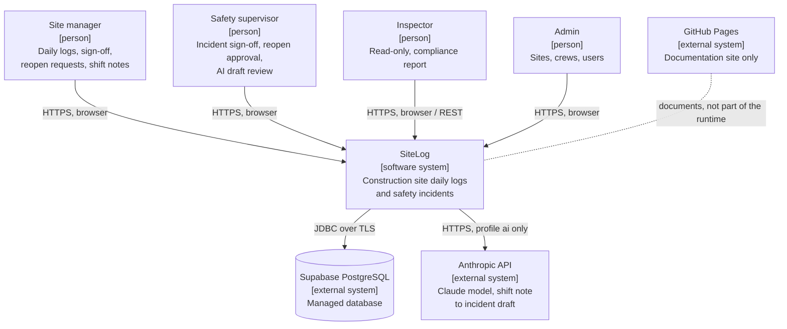
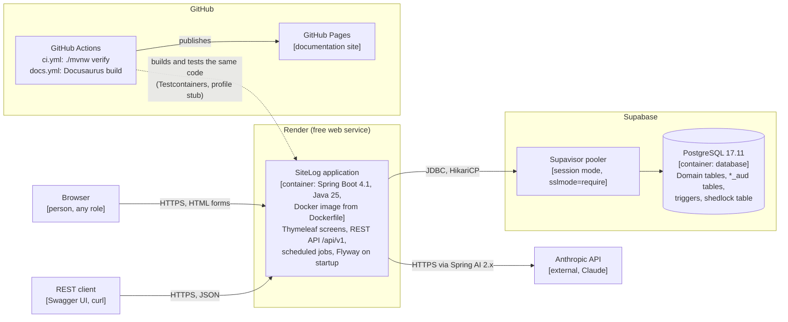
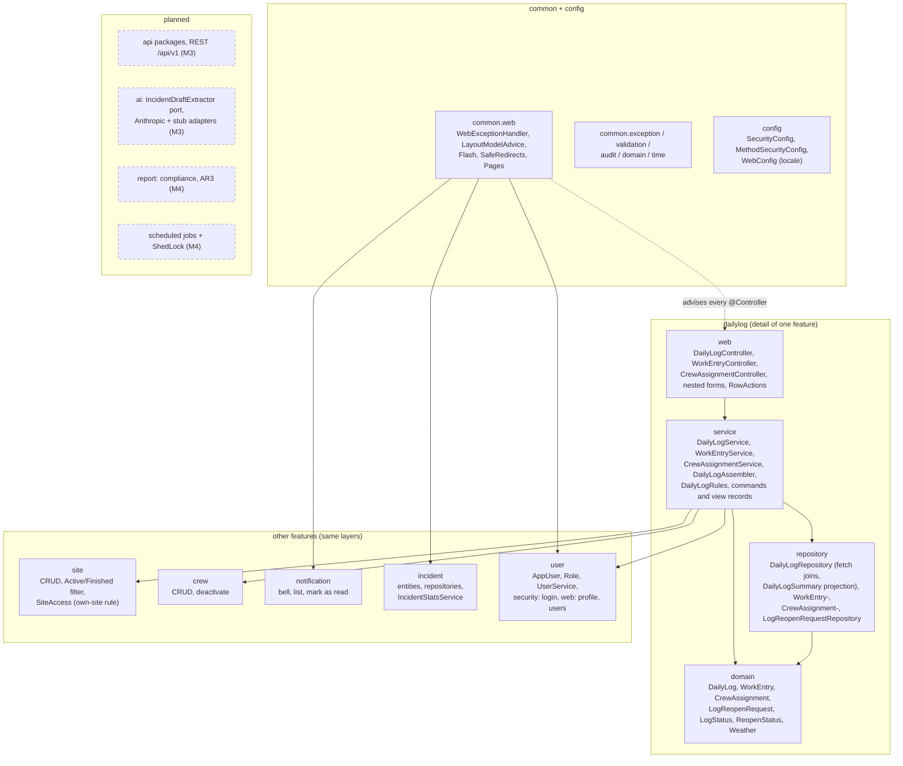
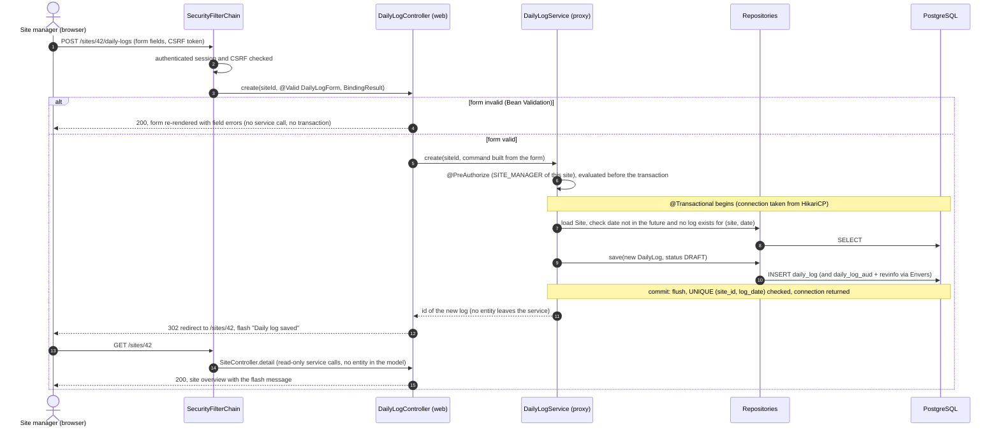
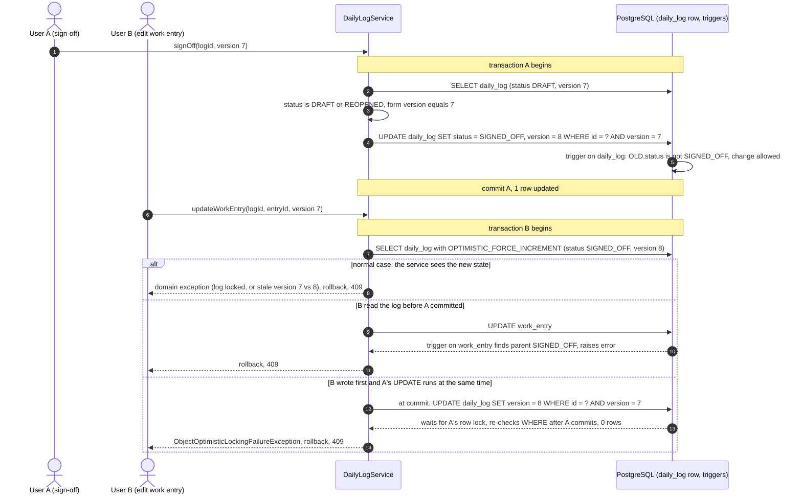
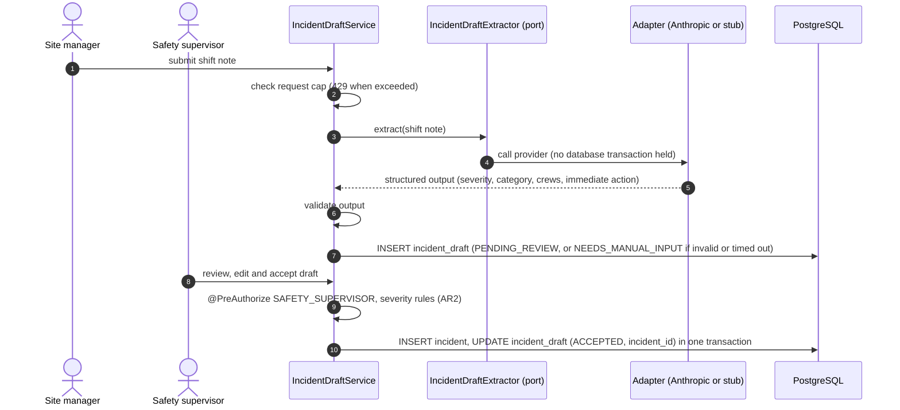
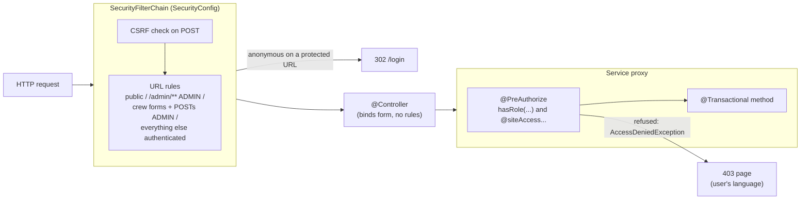
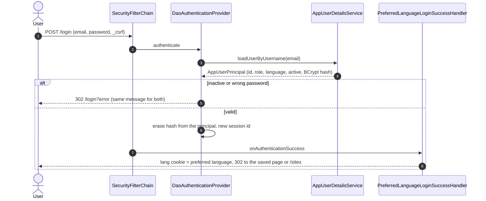
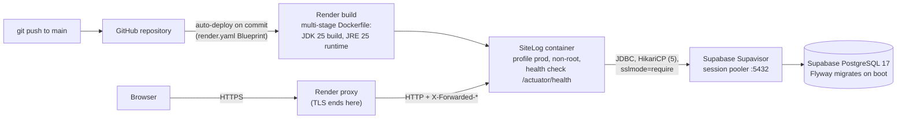

# Architecture overview

:::info Status (2026-11-24, milestone M3 week 9)
**Implemented** today: the M1 skeleton (Flyway, `ddl-auto=validate`, `open-in-view=false`, the
`dev` profile, Testcontainers tests); from M2, the database (migrations `V2`–`V6`), the JPA
entities with the Envers mapping, the services and the Thymeleaf screens for sites, crews, daily
logs (with work entries and crew rows), notifications and the error pages, in English and
Croatian; from M3 week 9, login with the four roles and method-level authorization
([section 8](#8-security)), user administration and password change, and the deployment setup
(`prod` profile, Dockerfile, Render Blueprint; [section 9](#9-deployment)). Everything else
marked M3/M4 on this page is **planned**. The domain is described in the [domain model](./domain-model.md);
persistence choices in [ADR-0001](../adr/0001-persistence-model.md); the reopen audit trail in
[ADR-0003](../adr/0003-reopen-audit-trail.md); the physical schema in
[Database schema](./database.md).
:::

## 1. System context

Who uses SiteLog and which external systems it depends on. Diagrams use Mermaid flowcharts
in the C4 style (Mermaid's native C4 syntax is experimental).

| Element | Status |
|---|---|
| Four roles | Implemented (M3 week 9): form login with the users of `app_user`, one role each ([section 8](#8-security)). |
| Supabase PostgreSQL | Chosen in M1 ([ADR-0001](../adr/0001-persistence-model.md)); `prod` profile, deployed in M3 week 9 ([section 9](#9-deployment)). |
| Anthropic API | Chosen in M1; AI feature in M3 (ADR-0002). Called only when profile `ai` is active. |
| GitHub Pages | Implemented: `docs.yml` publishes this site. It is not the application deployment. |

## 2. Containers

| Container | Technology | Status |
|---|---|---|
| SiteLog application | Spring Boot 4.1 jar in a Docker image on Render | Multi-stage `Dockerfile` and `render.yaml` implemented (M3 week 9); runs locally with `docker compose up`. Deployed on Render (https://sitelog-aq2e.onrender.com) in M3 week 9. |
| Database | PostgreSQL 17 — `postgres:17-alpine` locally and in tests, Supabase 17.11 in production | Local + tests implemented (M1). Domain schema: implemented, migrations `V2`–`V6` ([Database schema](./database.md)). Supabase: connection settings in `application-prod.yml`, deployed in M3 week 9 (session pooler). |
| AI provider | Anthropic Claude through Spring AI 2.x | M3. |
| CI | GitHub Actions `ci.yml` (`./mvnw verify`), `docs.yml` (this site) | Implemented (M1). |

## 3. Components (inside the application)

Base package `hr.algebra.sitelog`, split **by feature**, each feature split **by layer**
(`domain`, `repository`, `service`, `web`). The diagram shows the packages that exist today
(solid) and the ones planned for M3–M4 (dashed).

| Package | Contents today | Status |
|---|---|---|
| `config` | `SecurityConfig` (filter chain: URL rules, form login, logout, BCrypt encoder), `MethodSecurityConfig` (`@EnableMethodSecurity`), `WebConfig` (`CookieLocaleResolver` + `LocaleChangeInterceptor`). | M3 week 9 (security), M2 (locale). |
| `common.domain` | `BaseEntity`: identity key, equality by id. | M2. |
| `common.exception` | `DomainException` (message key + arguments) and its subclasses `NotFoundException`, `InvalidFieldException`, `InvalidTransitionException`, `LogLockedException`, `DeletionNotAllowedException`. | M2. |
| `common.validation` | `@Chronological` class-level constraint (end not before start) and its validator. | M2. |
| `common.audit` | Envers revision entity `AuditRevision` (`revinfo`) and `AuditRevisionListener` (stores the user's email, or `system`). | M2 (mapped and writing revisions). |
| `common.time` | `TimeConfig`: one `Clock` bean in `sitelog.time-zone` (Europe/Zagreb). | M2. |
| `common.web` | `WebExceptionHandler`, `LayoutModelAdvice` (the two `@ControllerAdvice`s, section 7), `Flash` (flash message keys), `SafeRedirects` (back to the referer only if it is a local path), `Pages` (caps page size and whitelists sort fields). | M2. |
| `user` | `domain`: `AppUser`, `Role`, `RoleName`. `security`: `AppUserDetailsService` (login lookup), `AppUserPrincipal` (the user kept in the session), `PreferredLanguageLoginSuccessHandler`. `service`: `UserService` (administration, profile, password change), `PasswordPolicy`, `CurrentUserProvider` with `SecurityContextCurrentUserProvider`. `web`: `LoginController`, `ProfileController`, `UserAdminController` (`/admin/users`), forms with `@PasswordLength`. | M2 (entities); M3 week 9 (login, administration, profile). |
| `site` | CRUD screens, `Active` / `Finished` filter computed in the query, delete rule; `service.SiteAccess`, the `@siteAccess` bean of the own-site rule ([section 8](#8-security)). | M2; `SiteAccess` M3 week 9. |
| `crew` | CRUD screens, delete only if unused, otherwise deactivate. | M2. |
| `dailylog` | Aggregate `DailyLog → WorkEntry → CrewAssignment`: nested form, separate work entry and crew row pages, detail with lock notice, sign-off, delete; `LogReopenRequest` entity. | M2 (CRUD, sign-off, lock). Reopen workflow and audit view: M3. |
| `incident` | `Incident`, `CorrectiveAction`, enums, repositories; `IncidentStatsService` (open incident counter in the sidebar). | M2 (entities). Screens and severity workflow (AR2): M3. |
| `notification` | `Notification` entity, bell data, list page, *mark as read*, *mark all as read*, *open*. | M2 (reading). Producers: M3/M4. |
| `api` (per feature) | REST controllers under `/api/v1`, request/response records, `@RestControllerAdvice` with `ProblemDetail`, springdoc. | M3. |
| `ai` | Port `IncidentDraftExtractor`, Anthropic and stub adapters, draft review flow. | M3. |
| `report` | Compliance report per site and period (AR3). | M4. |
| Scheduled jobs | Overdue corrective actions, unsigned log reminder; lock strategy in ADR-0004. | M4. |

## 4. Layering rules

| Layer | Contains | May call | Must not |
|---|---|---|---|
| `web` | `@Controller`, form objects (`DailyLogForm`, `WorkEntryForm`, ...; Bean Validation annotations), view names | its own and other features' `service` (for example the crew options of the daily log form) | contain business rules; touch repositories; open transactions; put entities in a form backing object |
| `api` | `@RestController` under `/api/v1/...`, request/response **records**, mappers entity → record | its feature's `service` | return entities; contain business rules |
| `service` | `@Service` classes: business rules, state transitions, transactions (class-level `@Transactional(readOnly = true)`, `@Transactional` on writes), authorization (`@PreAuthorize`); **commands** in (`DailyLogCommand`, ...) and **view records** out (`DailyLogDetails`, `SiteListItem`, ...) | own `repository`, other features' `repository` for existence checks of the delete rules, other features' `service`, the AI port (M3) | depend on `web`/`api` types (HTTP, `Model`, `RedirectAttributes`); return entities to controllers |
| `repository` | Spring Data JPA interfaces; JPQL with fetch joins / `@EntityGraph`; record projections for reports | — | contain business decisions |
| `domain` | JPA entities, enums, domain exceptions; invariants that depend only on the entity's own state | — | depend on Spring MVC or on other layers |

Rules applied everywhere:

- **Constructor injection only** (no field `@Autowired`); a single constructor needs no annotation.
- **Thin controllers:** bind and validate the form → call one service method → redirect
  (POST-Redirect-GET) with a flash message, or re-render the form on validation errors.
- **Forms and DTOs are not entities.** Forms live in `web`, request/response records and their
  mappers in `api`. Mapping happens inside the service transaction or from a fully loaded
  object, because `open-in-view=false` makes lazy loading outside a transaction fail.
- **Domain exceptions → HTTP.** Services throw subclasses of `DomainException`, which carry a
  message key and arguments, never translated text. For screens: `InvalidFieldException` is
  caught by the controller and put on the form field (form re-rendered); everything else goes
  to `WebExceptionHandler` (section 7). For the REST API (M3) a `@RestControllerAdvice` turns
  the same exceptions into `ProblemDetail` (400 validation, 404 not found, 409 conflict / locked
  log / stale version, 422 business rule, 429 AI request cap).
- **Schema only through Flyway**; Hibernate validates (`ddl-auto=validate`). Implemented.

## 5. Profiles

Profiles are combined: one **datasource** profile plus one **AI** profile
(for example `dev,stub`, `prod,ai`). No profile has default credentials; secrets come from the
environment.

| Profile | Datasource | AI adapter | Secrets come from | Status |
|---|---|---|---|---|
| `dev` | PostgreSQL 17 from `docker-compose.yml`; pool settings shared from `application.yml` (5 by default) | — (combine with `stub` or `ai`) | git-ignored `.env` (template `.env.example`), read by Docker Compose and by Spring (`spring.config.import`) | Implemented (M1). |
| `test` | Testcontainers `postgres:17-alpine`, connection injected by `@ServiceConnection` | `stub` | none (container credentials are generated) | Testcontainers implemented (M1) without a named profile; `test` profile with the stub adapter in M3. |
| `stub` | — | `StubIncidentDraftExtractor`: deterministic drafts, no network | none | M3. Always used in tests and CI. |
| `ai` | — | `AnthropicIncidentDraftExtractor` via Spring AI 2.x; cheap configurable model, low `max-tokens`, request cap | `ANTHROPIC_API_KEY` environment variable | M3. |
| `prod` | Supabase through the Supavisor pooler, session mode, `sslmode=require`; Flyway migrates on startup | `ai` on Render (`stub` possible if the key is absent) | Render environment variables `DB_URL`, `DB_USERNAME`, `DB_PASSWORD` (optional `DB_POOL_SIZE`); AI key in M3 | `application-prod.yml` implemented (M3 week 9); AI part with the AI feature. |

Exactly one AI adapter bean exists at runtime: activating neither or both of `stub` and `ai`
fails at startup instead of picking a provider silently.

## 6. Request flows

### 6.1 Creating a daily log (screen, POST-Redirect-GET)

- **Transaction boundary:** starts when the call enters the service proxy and ends at commit,
  before the controller builds the redirect. The controller and the view run outside any
  transaction; with `open-in-view=false` they cannot trigger lazy loading.
- **Authorization:** `@PreAuthorize` is checked by the method-security interceptor, which by
  default sits outside the transaction interceptor, so a denied call never opens a transaction.
  A denial returns 403 (screen: error page; API: `ProblemDetail`).
- **Validation in two places:** field format on the form (`@NotNull`, `@Size`, ...); business
  rules (one log per site and day, site must be active) in the service, backed by the database
  constraint.
- **REST variant:** `POST /api/v1/sites/42/daily-logs` with a JSON request record goes to the
  **same** service method. Success answers `201 Created` with a `Location` header and a
  response record; a validation error answers 400 and a domain error its `ProblemDetail`
  status, instead of a re-rendered form or a flash message.

Status: screens, service and Envers implemented (M2); `@PreAuthorize` with real roles
implemented (M3 week 9); the REST variant in M3.

### 6.2 Signing off a daily log, and two users at the same time

The edit form and the sign-off form both carry the log's `version` as a hidden field.
Below, user A signs off while user B saves a change to a work entry of the same log; both
opened the page at `version = 7`.

- **Who wins:** whichever transaction updates the `daily_log` row first. PostgreSQL row locks
  serialize the two writes; under `READ COMMITTED` the loser's `WHERE version = 7` is
  re-evaluated against the committed row and matches nothing. The second request always ends
  in **409 Conflict** (`ProblemDetail` in the API, flash error plus reload on the screen); no
  update is lost.
- **Why `OPTIMISTIC_FORCE_INCREMENT`:** B changes only a child (`work_entry`). Without the
  forced increment the root's `version` would not change and the conflict with A's sign-off
  could go unnoticed ([ADR-0001](../adr/0001-persistence-model.md), decision 6).
- **Where the triggers act:** last line of defence. The service rejects edits of a
  `SIGNED_OFF` log first (domain exception → 409); the triggers on `daily_log`, `work_entry`
  and `crew_assignment` reject any `INSERT`/`UPDATE`/`DELETE` that reaches the database anyway
  (a bug in the service, a race like the second branch above, or manual SQL). The exact rules
  are in [Database schema — Locked daily logs](./database.md#locked-daily-logs).
- **Reopen** follows the same pattern: a `LogReopenRequest` with a reason; on approval by a
  safety supervisor the log goes to `REOPENED`, `revision` + 1, and the changes made while
  reopened are read back from the Envers revisions
  ([ADR-0003](../adr/0003-reopen-audit-trail.md)).

Status: implemented in M2 for sign-off and child edits — version check in the service
(`DailyLogRules.requireVersion`), `OPTIMISTIC_FORCE_INCREMENT` (`findForChildUpdateById`),
triggers, 409 page. The stale-version and lock cases are tested against PostgreSQL in `DailyLogAggregateFlowTests`
(`childChangeBumpsTheLogVersionAndAStaleVersionIsRefused`, `signOffLocksTheLogAndItsChildren`).
The reopen workflow is M3; a test with two threads signing off at the same time is M4.

### 6.3 Shift note → AI draft → supervisor review

The AI never writes an `Incident`. The provider call happens before the transaction that saves
the draft, so a slow provider does not hold a database connection. Status: M3 (details in
ADR-0002 and `docs/ai-evaluation.md`).

## 7. Cross-cutting concerns

| Concern | Design | Status |
|---|---|---|
| **Security** | Form login with users from the database (BCrypt), four roles. URL rules in the `SecurityFilterChain` (public: health check, login, static assets); business authorization with `@PreAuthorize` on service methods, including ownership checks (a site manager only edits logs of the sites they manage). The Thymeleaf security dialect hides actions; it does not replace the service check. REST API secured with the same rules. | **Implemented in M3 week 9** for the screens ([section 8](#8-security)); REST API rules with the API (M3). |
| **Auditing** | Three layers: `LogReopenRequest` records **why** and who requested/approved; a domain `@Aspect` records **which action** (sign-off, reopen, incident transitions) and by whom; Hibernate Envers records **what changed** (before/after per revision) on `DailyLog`, `WorkEntry`, `CrewAssignment`. See [ADR-0003](../adr/0003-reopen-audit-trail.md). | Envers **implemented in M2**: `@Audited` on the three entities, `AuditRevision` + `AuditRevisionListener` write `revinfo` with the user (or `system`), append-only tables (V5). Reopen workflow, `@Aspect` and the before/after view: **M3**. |
| **Concurrency** | `@Version` on `DailyLog` and `Incident`; `OPTIMISTIC_FORCE_INCREMENT` when a child changes; conflict → 409 (section 6.2). | Implemented in M2 (version from the form, forced increment, 409 page). Two-thread sign-off test **planned for M4**. |
| **i18n** | All UI text from `messages.properties` (en) and `messages_hr.properties` (hr); `fallback-to-system-locale: false`, so an unsupported language falls back to English. `WebConfig`: `?lang=hr` is read by a `LocaleChangeInterceptor` and stored in the `lang` cookie by a `CookieLocaleResolver` (default English, one year); an invalid value is ignored. Flash messages and domain errors are message keys, translated when the page renders. | **Implemented in M2** for every existing screen, validation and error page. The user's `preferred_language` is applied at login (M3 week 9). |
| **Error handling** | Domain exceptions thrown by services; `@RestControllerAdvice` → `ProblemDetail` for `/api/v1`; screens get flash errors or an error page. No stack traces or internal messages in responses (`include-stacktrace: never`, `include-message: never` outside `dev`). | Screens **implemented in M2** (see below); REST `ProblemDetail` handler **M3**. |
| **Scheduling** | Two daily `@Scheduled` jobs (overdue corrective actions, unsigned log reminder), protected against double execution by ShedLock (ADR-0004). Each job calls a service method, which holds the transaction. | **Planned for M4**. |
| **Transactions** | `@Transactional` on services only (`readOnly = true` for queries); `open-in-view=false`. | Implemented (M1/M2). |
| **Health** | `/actuator/health` public, used by Docker and the Render health check; no details exposed. | Implemented (M1). |

### Controller advices (screens)

Two `@ControllerAdvice` classes in `common.web` serve the Thymeleaf screens.

| Advice | Scope | What it does |
|---|---|---|
| `WebExceptionHandler` | `annotations = Controller.class` | Optimistic-lock conflict (stale version from the form, or concurrent commit) → **409** page `error/409` with "changed by someone else" and a reload link. `LogLockedException` → redirect to the log detail with an error flash. `InvalidTransitionException`, `DeletionNotAllowedException` → redirect back (`SafeRedirects`) with the error flash. `NotFoundException` → **404** page. `DataAccessException` whose cause is the `daily_log_locked` trigger message, or any `DataIntegrityViolationException` → **409** page; anything else is re-thrown to the generic error page. |
| `LayoutModelAdvice` | `basePackages = "hr.algebra.sitelog"` | Adds what the layout needs to every model: `currentUser`, `unreadCount`, the newest 10 unread `notifications`, `openIncidentCount`. |

`LayoutModelAdvice` is restricted to the application's own package on purpose: Spring Boot's
`BasicErrorController` (403, 404 for unknown URLs, 500) must render even when the database is the
cause of the error, so the error pages do not query it, and the layout treats those attributes as
optional. The error templates (`error/403.html`, `404`, `409`, `500`, fallback `error.html`) show
translated text only, never a stack trace or exception message.

## 8. Security

Implemented in M3 week 9. Two layers, each with its own job: the **filter chain** decides who
may reach a URL at all, **method security** on the services decides who may perform an
operation. The services are the rule; the URL rules and the hidden buttons are additional.

### URL level: `SecurityConfig`

| Rule | Paths | Why at URL level |
|---|---|---|
| Public | `/login`, `/error`, `/actuator/health`, `/css/**`, `/js/**`, `/img/**`, `/favicon.ico` | Needed before sign-in (login page and its assets) and by the Docker / Render health check. |
| `ADMIN` | `/admin/**` (user administration) | Second line of defence next to `@PreAuthorize("hasRole('ADMIN')")` on `UserService`. |
| `ADMIN` | `GET /crews/new`, `GET /crews/*/edit`, every `POST` under `/crews` | Refused before form binding and validation, so a non-admin never sees the crew form, not even re-rendered with errors. The crew list stays readable. |
| Signed in | everything else | Every page shows site data; no anonymous reading. |

### Method level: `@PreAuthorize` on the services

`MethodSecurityConfig` carries `@EnableMethodSecurity`. Every service class has
`@PreAuthorize("isAuthenticated()")` for its read methods, and each write method narrows it:

| Service methods | Expression |
|---|---|
| Sites (create, update, delete, manager options), crews (create, update, delete), all of `UserService` except the profile | `hasRole('ADMIN')` |
| `DailyLogService.create`, `SiteService.getSummaryForNewLog` (the *New daily log* form) | `hasRole('SITE_MANAGER') and @siteAccess.canManageSite(#siteId)` |
| Daily log update, sign-off, delete, edit form; work entry and crew row create / update / delete | `hasRole('SITE_MANAGER') and @siteAccess.canManageLog(#dailyLogId)` (or `#id`) |
| Profile, preferred language, password change | `isAuthenticated()` |

- **Why on the services:** the REST API (M3) and any future caller go through the same methods,
  so one rule protects screens and API. A refused call throws `AccessDeniedException` before the
  method body and before the transaction opens.
- **`SiteAccess`** (`site.service`, bean name `siteAccess`) answers only "is the signed-in user
  the manager of this site / of this log's site?" (`existsByIdAndManager_Id`,
  `existsByIdAndSite_Manager_Id`). The role is checked in the expression itself. An id that does
  not exist answers `true`, so the service throws its not-found exception and the user sees 404
  instead of a misleading 403; nothing is revealed, since every signed-in user may read every site.
- **Why a separate `MethodSecurityConfig`:** the `@WebMvcTest` slices import `SecurityConfig` and
  mock the services. Keeping `@EnableMethodSecurity` out of `SecurityConfig` keeps those slices
  free of method-security proxies; the rules are tested on the real services instead
  (`MethodSecurityTests`, `RoleAccessMatrixTests`).
- **In the templates** the Thymeleaf security dialect hides actions the user may not perform:
  `sec:authorize="hasRole('ADMIN')"` for admin actions, and for the own-site rule a flag computed
  once per page with `th:with` (`#authorization.expression('hasRole(''SITE_MANAGER'')') and
  @siteAccess.canManageSite(site.id)`, or `canManageLog(log.id)` on the log detail). This is
  cosmetic only.

The resulting permission matrix per role is in
[Domain model — Permissions implemented today](./domain-model.md#permissions-implemented-today).

### Login, session and logout

| Topic | Implementation |
|---|---|
| Users | `AppUserDetailsService` looks the e-mail up case-insensitively in `app_user` with its role (one query). `AppUserPrincipal` is a copy of the row, not the JPA entity (the session outlives the persistence context); authority `ROLE_<role>`. |
| Passwords | `BCryptPasswordEncoder` (strength 10), the same algorithm as the hashes in the `V4` seed. Policy: at least 12 characters, at most 72 bytes (BCrypt's input limit); a change requires the current password and a confirmation. |
| Inactive user | `isEnabled()` is the `active` flag; the provider refuses the login before checking the password. The page shows the same message as for a wrong password, so it does not reveal which e-mails exist. |
| Language at login | `PreferredLanguageLoginSuccessHandler` writes the user's `preferred_language` through the application's `LocaleResolver` (the `lang` cookie of section 7), then continues to the saved request or `/sites`. |
| Current user | `SecurityContextCurrentUserProvider`: `currentUserId()` reads the id from the principal without a query; `findCurrentUser()` reloads name and role, so a name changed on the profile shows at once. The Envers `AuditRevisionListener` records the same user. |
| CSRF | On (Spring Security default). Thymeleaf forms with `th:action` get the hidden `_csrf` field automatically; a POST without a valid token answers 403. |
| Session | HTTP session with Spring Security's default session-fixation protection (new session id at login). In `prod` the cookie is `Secure`, `HttpOnly`, `SameSite=Lax`. |
| Logout | `POST /logout` with the CSRF token (a GET link cannot log anyone out); invalidates the session, deletes `JSESSIONID`, redirects to `/login?logout`. |
| Refused calls | Signed-in user → 403 page in the user's language; anonymous → redirect to `/login`. Tested over real HTTP in `ForbiddenCallsHttpTests` (database unchanged after a refused POST, missing or forged CSRF token, inactive user, logout, session fixation). |

## 9. Deployment

Deployment setup and first deployment on Render (https://sitelog-aq2e.onrender.com) in M3 week 9. Full
procedure, environment variables, redeploy and the wake-up steps before a demo:
[Deployment (Render + Supabase)](../operations/deployment.md).

| Decision | Choice | Reason |
|---|---|---|
| Image | Multi-stage `Dockerfile` (`eclipse-temurin:25-jdk-alpine` build, `25-jre-alpine` runtime), not buildpacks | The same image runs locally (`docker compose up`) and on Render; the build is explicit and reviewable; the runtime has no JDK or Maven and runs as a non-root user. |
| Service definition | `render.yaml` Blueprint (free plan, Frankfurt, auto-deploy on commit, health check) | Versioned with the code; secrets are only names (`sync: false`), values are entered in the Render dashboard. |
| Database connection | Supavisor **session** pooler, port 5432, TLS required | The direct connection is IPv6 only, which Render does not reach; the transaction pooler (6543) breaks server-side prepared statements and session state. In session mode each Hikari connection holds one pooler connection, hence the small pool (README, *HikariCP configuration*). |
| Configuration | `application-prod.yml` reads `DB_URL`, `DB_USERNAME`, `DB_PASSWORD` with no defaults | A missing variable fails the startup instead of connecting somewhere else; Render keeps the previous deploy. |
| Exposure | Only `/actuator/health` (no details); no stack trace or message in error responses | Nothing about the configuration leaks through the deployed instance. |
| Startup on 0.1 CPU | `JAVA_TOOL_OPTIONS=-XX:MaxRAMPercentage=75 -XX:TieredStopAtLevel=1 -XX:+UseSerialGC` | Measured locally with the free plan's limits: 349 s → 168 s to start, at the cost of peak throughput the application does not need. |
