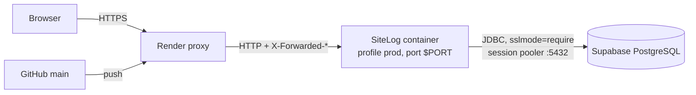

# Deployment: Render + Supabase

The application runs as a **Docker web service on Render**, built from the repository's
**multi-stage `Dockerfile`** (not from Render's native Java runtime or buildpacks). The database is
**Supabase** (managed PostgreSQL 17), reached through the **Supavisor pooler in session mode** with
TLS required. Flyway creates and migrates the schema, including the demo data, on the first boot.



## How the image is built

| Stage | Base image | What happens |
|---|---|---|
| `build` | `eclipse-temurin:25-jdk-alpine` | `./mvnw dependency:go-offline` (cached layer while `pom.xml` is unchanged), then `./mvnw package -DskipTests`; the jar is extracted into layers (`java -Djarmode=tools ... extract --layers`). |
| runtime | `eclipse-temurin:25-jre-alpine` | Only the JRE and the extracted jar (`/app/app.jar` + `/app/lib`). Runs as the unprivileged user `sitelog`. `JAVA_TOOL_OPTIONS` sizes the heap from the container limit and starts faster on a small CPU share (see below). |

- Tests are not run in the image build; CI runs `./mvnw verify` (with Testcontainers) on every push.
- `.dockerignore` is an allow-list (`mvnw`, `.mvn/`, `pom.xml`, `src/`): `.env`, `.git`, `target/`
  and `docs/` never enter the build context, so they cannot end up in the image.
- The `HEALTHCHECK` in the Dockerfile is used by Docker Compose; Render runs its own check on the
  same path.

### Startup on the free instance

The Render free instance has 512 MB of memory and 0.1 CPU. The same limits were reproduced locally
with `docker run --memory=512m --cpus=0.1` against the Compose database:

| `JAVA_TOOL_OPTIONS` | Startup (`Started SiteLogApplication in ...`) | Memory after start |
|---|---|---|
| `-XX:MaxRAMPercentage=75` | 349 s | 333 MiB |
| `-XX:MaxRAMPercentage=75 -XX:TieredStopAtLevel=1 -XX:+UseSerialGC` (chosen) | 168 s | 315 MiB |

`TieredStopAtLevel=1` keeps only the fast C1 compiler: less CPU spent compiling at startup, lower
peak throughput, which a low-traffic application does not need. Render's own CPU share may differ
from the local throttling, so the real cold start is measured after the first deploy.

## Configuration: the `prod` profile

`src/main/resources/application-prod.yml` reads every connection value from environment
variables **without defaults**. A missing variable makes the startup fail (Flyway cannot connect),
so a broken configuration never goes live: Render keeps the previous deploy running.

| Setting | Value | Why |
|---|---|---|
| `spring.datasource.url/username/password` | `${DB_URL}`, `${DB_USERNAME}`, `${DB_PASSWORD}` | No credential in the repository or the image. |
| `spring.datasource.hikari.data-source-properties.sslmode` | `require` | TLS to Supabase even if the URL forgets `sslmode`. A parameter written in the URL wins (driver rule); Docker Compose uses that to disable TLS for the local container. |
| `server.port` | `${PORT:8080}` | Render injects `PORT`. |
| `server.forward-headers-strategy` | `framework` | Render terminates HTTPS and forwards `X-Forwarded-Proto/Host`; redirects (for example to `/login`) then use `https://` and the public host. |
| `server.servlet.session.cookie.*` | `secure: true`, `http-only: true`, `same-site: lax` | Session cookie only over HTTPS, not readable by JavaScript, not sent on cross-site POSTs. |
| `server.error.include-*` | `never` / `false` | No stack trace, exception message, exception class or binding errors in any error response. |
| `management.endpoints.web.exposure.include` | `health` | `/actuator/env`, `/configprops`, `/heapdump` etc. are not exposed (404 even when logged in). |
| `management.endpoint.health.show-details` | `never` | `/actuator/health` answers only `{"status":"UP"}`. |
| `spring.jpa.hibernate.ddl-auto` | `validate` | The schema belongs to Flyway; Hibernate only checks it. |
| `spring.flyway.enabled` | `true` | Migrations run on every boot; applied ones are skipped. |

HikariCP settings are shared by all profiles and explained in the README (section *HikariCP
configuration*); only the maximum pool size is adjustable here, with `DB_POOL_SIZE`.

## Environment variables (Render → service → Environment)

| Variable | Example / format | Where the value comes from |
|---|---|---|
| `SPRING_PROFILES_ACTIVE` | `prod` | Fixed value (set by `render.yaml`). |
| `DB_URL` | `jdbc:postgresql://aws-0-eu-central-1.pooler.supabase.com:5432/postgres?sslmode=require` | Supabase → **Connect** → **Session pooler** (see below), converted to JDBC form. |
| `DB_USERNAME` | `postgres.<project-ref>` | Same dialog: the pooler user includes the project reference after the dot. |
| `DB_PASSWORD` | the database password | Chosen when the Supabase project was created; reset in Supabase → Project Settings → Database → *Reset database password*. |
| `DB_POOL_SIZE` | `5` | Optional (default 5). Keep it below the pooler's client limit of the plan, see below. |
| `PORT` | set by Render | Do not set it. |

The variables for the AI feature (`ANTHROPIC_API_KEY` and the request cap) are added to this table
together with the feature.

## First deployment

### 1. Supabase: the database

1. Create (or open) the project at [supabase.com](https://supabase.com). Region: **Central EU
   (Frankfurt)**, `eu-central-1`. Keep the database password in a password manager.
2. Open **Connect** (top of the project page). Choose the **Session pooler** connection
   (Supavisor, **port 5432**), not *Direct connection* (IPv6 only, which Render does not reach)
   and not *Transaction pooler* (port 6543, which breaks server-side prepared statements and
   session state that Hibernate and Flyway rely on).
3. The dialog shows a URI like
   `postgresql://postgres.<project-ref>:[YOUR-PASSWORD]@aws-0-eu-central-1.pooler.supabase.com:5432/postgres`.
   Turn it into the three variables:
   - `DB_URL` = `jdbc:postgresql://` + host + `:5432/postgres?sslmode=require`
     (no user and no password in the URL);
   - `DB_USERNAME` = `postgres.<project-ref>`;
   - `DB_PASSWORD` = the database password.
4. Pool limit: in **Project Settings → Database → Connection pooling**, read the *Pool size* /
   *Max client connections* of the plan. In session mode every Hikari connection occupies one
   pooler connection for as long as it is open, and the dashboard and SQL editor use the same pool.
   `DB_POOL_SIZE` (default 5) must stay clearly below that number.
5. Do **not** create tables by hand: Flyway creates everything on the first boot.

### 2. Render: the web service

Recommended: **Blueprint** (the service definition is versioned in `render.yaml`).

1. Render dashboard → **New → Blueprint** → connect the GitHub repository → branch `main`.
2. Render reads `render.yaml` and asks for the values marked `sync: false`: paste `DB_URL`,
   `DB_USERNAME`, `DB_PASSWORD` from step 1. Confirm (**Apply**).
3. The first build takes a few minutes (Maven downloads the dependencies). Follow it in **Logs**:
   Flyway lists the migrations `V1`…`V6`, then `Started SiteLogApplication`.
4. Open `https://<service-name>.onrender.com/actuator/health` → `{"status":"UP"}`.

Equivalent manual setup (if a Blueprint is not used): **New → Web Service** → repository → 
*Language* **Docker**, *Branch* `main`, *Region* **Frankfurt (EU Central)**, *Instance type*
**Free**, *Dockerfile path* `./Dockerfile`; under **Advanced**: *Health Check Path*
`/actuator/health`, *Auto-Deploy* **On Commit**; add the variables of the table above under
**Environment**.

## Redeploy (rehearsal for the defence)

Two ways, both must be known:

1. **Commit on `main`**: `git push` to `main` → Render starts a build automatically (auto-deploy
   on commit). The old version keeps serving until the new one passes the health check.
2. **Manual Deploy** button: service page → **Manual Deploy → Deploy latest commit** (or
   *Clear build cache & deploy* if a dependency change behaves strangely).

Rehearsal: make a harmless change (for example a README line), push it, watch **Events** go from
*Deploy started* to *Deploy live*, and reload the site. Then repeat with the **Manual Deploy**
button. A changed environment variable also needs a redeploy (Render offers *Save, rebuild and
deploy*).

## Cold start and pausing

- **Render free instance** spins down after a period without traffic (Render documents 15
  minutes). The next request wakes it; the first page can take a few minutes (about 3 minutes in
  the local measurement above) while the container and the JVM start. This is expected on the
  free plan.
- **Supabase free project** is paused after a period of inactivity (Supabase documents one week).
  While paused, the application cannot start or answer (connection errors in the Render logs;
  health check fails).

Before the defence or any demo (do it the day before **and** about 30 minutes before):

1. Supabase dashboard → open the project. If it says *Paused*, click **Restore project** and wait
   until it is *Healthy* (it can take several minutes).
2. Open the Render URL `/actuator/health` and wait for `{"status":"UP"}`. If the service crashed
   while the database was paused, press **Manual Deploy → Deploy latest commit**.
3. Log in once with each role to warm up the pages.

## Security checks done for this deployment

- No secret in the repository: `.env` is git-ignored, `.env.example` and `render.yaml` contain only
  variable names; values live in the Render dashboard.
- No secret in the image: allow-list `.dockerignore`; checked with
  `docker run --rm --entrypoint sh sitelog-app:local -c 'find / -name ".env*"'` (nothing found)
  and `docker history --no-trunc` (only `PORT` and `JAVA_TOOL_OPTIONS` as `ENV`).
- No secret in responses: error pages and JSON errors never include stack trace or message;
  `/actuator/env`, `/actuator/configprops`, `/actuator/heapdump` return 404 even for a logged-in
  user; `/actuator/health` returns only the status.
- The container runs as a non-root user.

## Run the production image locally

```bash
cp .env.example .env        # set POSTGRES_PASSWORD
docker compose up --build   # PostgreSQL + the app with profile prod, http://localhost:8080
curl localhost:8080/actuator/health
docker compose down         # keeps the data volume (add -v to delete it)
```

The `app` service uses the same image and profile as Render; only the database differs (the local
container, with `sslmode=disable` because it has no TLS certificate). The session cookie is
`Secure`, which browsers accept on `http://localhost`.
